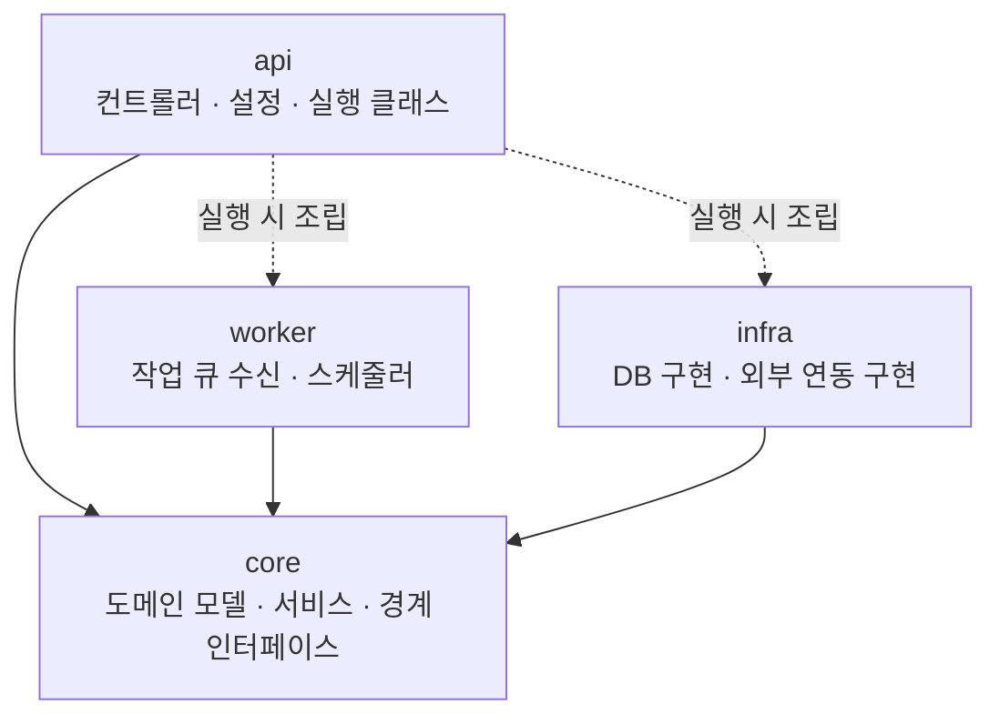
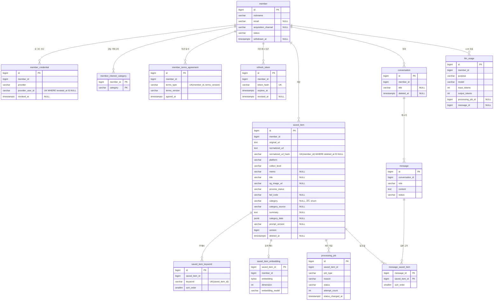
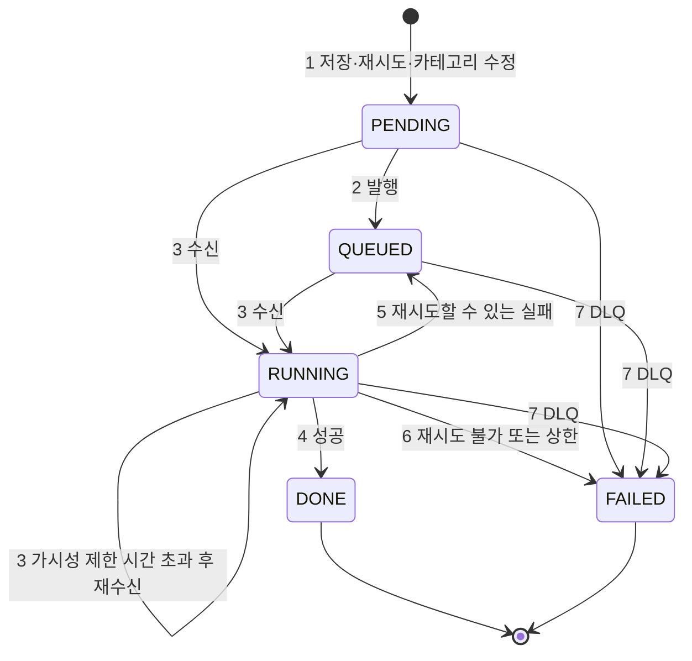
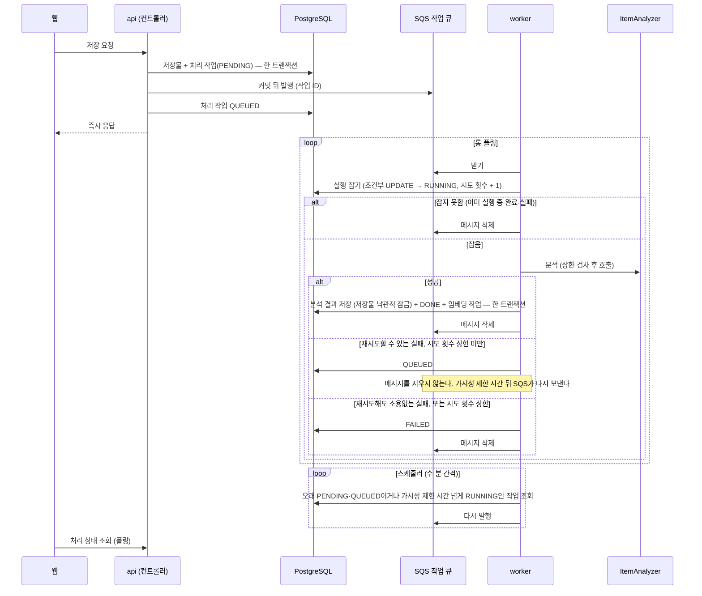

# 서버 아키텍처

| 항목 | 내용 |
| --- | --- |
| 범위 | 배포 구성, 모듈·패키지 구조, 도메인 모델, 확장 지점, 공통 규약 |
| 범위 밖 | 에이전트 작업 규칙([.claude/rules/](../.claude/rules/)), 테스트 전략([testing.md](testing.md)), 브랜치·커밋 규칙([conventions.md](conventions.md)), 빌드·배포([deployment.md](deployment.md)) |

> 이 문서는 프리런칭 기준의 서버 구조다. 기능 범위의 원본은 [plan/scope.md](plan/scope.md)다.
> 확정된 내용은 [10. 결정 기록](#10-결정-기록)에, 아직 정하지 않은 내용은 [11. 남은 결정](#11-남은-결정)에 모았다. 본문의 `[제안]`은 남은 결정에 해당하는 부분이다.

---

## 1. 전제와 제약

- **서비스**: 저장만 하고 다시 쓰지 않는 정보를 "저장 → 다시 꺼내기 → 재사용"하게 만든다.
- **방향**: 사용자가 저장한 링크로 관심사를 해석하고, 목적이 생기면 내 저장물에서 찾아 묶어 준다. 입력은 링크만 받는다. 이미지 입력은 프리런칭 범위 밖이다.
- **일정·인력**: UT 11/28, 프리런칭 12/12. 서버 2명, 퇴근 후 작업.
- **규모**: 프리런칭 사용자 30명 이하. 이후 확장을 전제로 한다.
- **비용**: 서버·LLM 비용을 팀이 직접 부담한다. 서버는 최소 사양으로 시작한다.
- **핵심 지표**: 자발 재열람 (알림을 통하지 않고 검색·목록으로 다시 여는 것).
- **스택**: JDK 25, Kotlin 2.3, Spring Boot 4.1(Spring MVC, 가상 스레드), Gradle 9, PostgreSQL 16, Amazon SQS(작업 큐), Swagger(springdoc). 정확한 버전은 `gradle/libs.versions.toml`과 Gradle wrapper 설정이 원본이다.

## 2. 설계 원칙

1. **한 프로세스로 시작하고, 나눌 수 있게 만든다.** 실행 파일은 하나지만 코드는 모듈로 나눠, 배포 단위나 DB 기술이 늘어날 때 모듈 추가로 대응한다.
2. **바뀔 수 있는 기술은 경계 뒤에.** LLM 벤더, 작업 큐, 링크 수집, 알림 채널처럼 바뀔 수 있는 부분은 경계 인터페이스 뒤에 둔다.
3. **개인정보 최소 수집.** 서버는 필요한 것만 받고 남긴다. 링크 본문은 분석에만 쓰고 저장하지 않는다. 작업 큐 메시지에는 작업 ID만 싣는다.
4. **비밀값은 환경변수로만.** 키·비밀번호·접속 문자열 실제값은 코드·설정·문서·커밋 어디에도 넣지 않는다. 저장소에는 `.env.example`(이름만)만 둔다.
5. **LLM 비용 통제.** 팀 공용 키를 쓰므로 모든 LLM 호출은 사용량 상한 검사를 거친다. 예상 비용은 서버보다 LLM 쪽이 크다.

## 3. 프리런칭 범위와 정해지지 않은 부분

결정 대기 번호는 [scope.md](plan/scope.md)의 "결정 대기" 표 번호다.

| 영역 | 프리런칭에서 만든다 | 정해지지 않음, 나중 |
| --- | --- | --- |
| 저장물 | 링크, 사용자 메모, 썸네일, 요약·카테고리·주제어, 처리 상태. 삭제는 소프트 딜리트 | 썸네일 저장 정책(결정 대기 3), 사용자가 만드는 카테고리(프리런칭 이후) |
| 가져오기 | 링크 단건 저장 | 카카오톡·플랫폼 일괄 가져오기(결정 대기 2, 4) |
| 분석 | 처리 작업 + SQS + 워커, 재시도, LLM 상한. 링크 본문·메타데이터 수집, 텍스트 LLM 분석, 임베딩 | 플랫폼별 수집 범위(결정 대기 1), LLM 모델(결정 대기 10) |
| 꺼내기 | 홈 관심사 카드, 채팅 검색, 열람 로그 | 채팅 검색 대상·결과 개수·지난 대화 저장(결정 대기 9) |
| 예약 작업 | 멈춘 작업 회수·남은 작업 재발행, 주간 푸시 대상 선정 | — |
| 알림 | 채널과 무관한 발송 기반 | 웹 푸시는 처리하지 않는다. 앱 푸시는 앱 출시 후 |
| 인증 | 카카오 로그인, JWT 액세스·리프레시 토큰(응답 본문 전달, 리프레시 로테이션), "현재 사용자" 추상화 | 구글 로그인(결정 대기 5) |
| 탈퇴 | 카카오 연결 끊기. 데이터는 프리런칭 기간 동안 보관 | 보관 근거·기간·프리런칭 후 처리(결정 대기 11) |

## 4. 배포 구성

- **한 프로세스**: API, 스케줄러, 워커가 같은 애플리케이션에서 돈다. 산출물은 컨테이너 이미지 1개다.
- **역할 켜고 끄기**: 워커와 스케줄러는 설정 플래그(`WORKER_ENABLED`, `SCHEDULER_ENABLED`)로 켜고 끈다. 같은 이미지를 컨테이너 두 개로 띄워 역할을 나누는 것이 코드 변경 없이 가능하다.
- **환경**: `local`(각자 PC, Docker Compose) / `dev`(개발 서버) / `prod`(운영 서버). 개발 서버를 먼저 띄웠다. 운영 환경 구성은 정하지 않았다. 개발 환경에서 테스트하며 정한다(11장).
- **개발 서버**: AWS Lightsail 서버 한 대(2GB)에 앱·PostgreSQL·Caddy(HTTPS) 컨테이너를 Docker Compose로 띄운다. 구성은 [deployment.md](deployment.md) 7절에 있다.
- **도메인**: 웹과 API를 같은 도메인 아래 서브도메인으로 둔다. 도메인과 호스트 이름은 정하지 않았다(11장). 그 전까지 개발 서버는 `sslip.io` 임시 주소를 쓴다.
- **배포 중 끊김 허용**: 무중단 배포는 하지 않는다. 배포로 중단된 처리 작업은 가시성 제한 시간 뒤 SQS가 다시 보낸다(8장).
- **DB 위치**: 개발 서버는 PostgreSQL을 앱과 같은 서버에 컨테이너로 띄운다. 관리형 DB는 서버 한 대 분의 비용이 더 든다.
- **DB 백업** `[제안]`: 하루 한 번 덤프를 서버 밖에 보관한다. 아직 만들지 않았다.
- **작업 큐**: SQS 표준 큐와 DLQ를 환경마다 따로 둔다. 설정값은 [deployment.md](deployment.md)에 둔다.
- **서버가 2대 이상이 될 때**: 스케줄 작업이 중복 실행되므로 잠금 장치가 필요하다. 워커는 처리 작업의 실행을 조건부 UPDATE로 잡으므로 같은 메시지를 여러 인스턴스가 받아도 한 번만 처리한다.

## 5. 모듈 구조



| 모듈 | 역할 | 의존 가능 대상 | 쓸 수 있는 기술 |
| --- | --- | --- | --- |
| `core` | 도메인 모델, 서비스, 경계 인터페이스 | 없음 | Spring의 DI·트랜잭션 어노테이션까지. JPA, 웹, HTTP 클라이언트, LLM SDK 금지 |
| `infra` | 경계 인터페이스의 구현. DB(`storage`), 외부 연동(`external`), 토큰 서명·검증(`security`)을 패키지로 나눈다 | `core` | JPA, PostgreSQL 드라이버, Flyway, HTTP 클라이언트, LLM SDK, AWS SDK(SQS), 푸시 SDK, Spring Security JOSE(JWT) |
| `api` | 요청으로 시작하는 진입점(컨트롤러)과 설정. 실행 모듈 | `core` (코드에서), `infra`·`worker` (실행 시 조립만) | Spring MVC, springdoc, actuator |
| `worker` | 요청 없이 도는 진입점(작업 큐 수신, 스케줄러) | `core` | Spring의 스케줄링 |

- 화살표는 전부 `core`를 향한다. `core`의 서비스는 자기 안의 경계 인터페이스만 알고, 구현이 어떤 기술인지 모른다.
- `api`는 `infra`·`worker`를 Gradle `runtimeOnly`로 의존한다. 컨트롤러에서 JPA 엔티티나 LLM 클라이언트를 직접 쓰면 컴파일되지 않는다.
- 실행 파일은 `api` 하나다. `worker`는 `api`가 실행할 때 포함해 같은 프로세스에서 돈다.
- SQS 수신 루프는 `worker`에 두고 `core`의 `JobQueue`로 메시지를 받는다. SQS 클라이언트는 `infra`의 구현만 쓴다.

**모듈 경계마다 컴파일러가 막아 주는 것**

| 경계 | 막는 것 |
| --- | --- |
| `core` ↔ `infra` | 서비스가 DB 기술, LLM SDK, HTTP 클라이언트를 직접 쓰는 것 |
| `api`·`worker` ↔ `infra` | 진입점이 서비스를 건너뛰고 구현을 직접 쓰는 것 |
| `api` ↔ `worker` | 컨트롤러와 워커가 서로의 코드를 부르는 것. 공유할 로직은 `core`의 서비스에 둔다 |

`infra` 안에서 저장소 구현과 외부 연동 구현이 서로를 부르는 것은 컴파일러가 막지 못한다. 코드 리뷰로 본다.

**확장할 때 하는 일**

| 생기는 일 | 하는 일 | 기존 코드 변경 |
| --- | --- | --- |
| DB 기술 추가 (캐시, 검색 등) | `infra`의 `storage`에 기술 패키지 추가 | `core`에 인터페이스 추가 |
| 워커·스케줄러를 따로 배포 | `worker`에 실행 클래스를 두고 실행 모듈로 전환 | 서비스는 `core`에, 워커 코드는 이미 `worker`에 있어 그대로 |
| 작업 큐 서비스 교체 | `infra`의 `external`에 구현 추가 | `JobQueue` 구현체 교체 |
| 입력 방식 추가 (이미지 등) | `infra`에 분석기·저장소 구현, `api`에 입력 컨트롤러 | `core`에 경계 인터페이스 추가 |

## 6. 패키지 구조

기본 패키지는 `com.depromeet.team1`이다. `[제안]` 각 모듈 안에서는 기능 단위로 먼저 나눈다.

```
core        com.depromeet.team1.core
├── item/               저장물
│   ├── Item.kt, ItemStatus.kt …     도메인 모델 (프레임워크 어노테이션 없음)
│   ├── ItemService.kt               서비스 (업무 흐름, 트랜잭션 경계)
│   ├── ItemRepository.kt            경계 인터페이스
│   └── ItemError.kt                 기능별 에러 코드
├── intake/             가져오기 묶음
├── processing/         처리 작업, 분석기·작업 큐 인터페이스
├── retrieval/          꺼내기 (홈 관심사, 채팅 검색)
├── viewlog/            열람 로그
├── notification/       알림 발송 인터페이스
├── user/               사용자
├── llm/                LLM 호출 인터페이스, 사용량 상한
└── common/             공통 에러 타입, 공용 값

infra       com.depromeet.team1.infra
├── storage/postgresql/
│   ├── item/           ItemJpaEntity, ItemJpaRepository(Spring Data), JpaItemRepository(구현), 변환 함수
│   ├── …               (core 의 기능 이름과 맞춘다)
│   └── config/         JPA 설정
├── external/
│   ├── llm/            LLM 클라이언트, 분석기 구현
│   ├── link/           링크 본문·메타데이터 수집 구현
│   ├── queue/          SQS 작업 큐 구현
│   ├── push/           알림 발송 구현
│   └── kakao/          카카오 로그인 구현(OAuthClient)
├── security/
│   └── jwt/            액세스 토큰 발급 구현(AccessTokenIssuer), JWT 서명 키, 검증용 JwtDecoder 빈
└── resources/db/migration/   Flyway 스크립트

api         com.depromeet.team1.api    (실행 클래스 ApiApplication 만 com.depromeet.team1 에 둔다)
├── web/<feature>/      컨트롤러, 요청·응답 DTO
├── web/common/         응답 포맷, 예외 변환, 현재 사용자 해석
└── config/             Swagger 등 설정

worker      com.depromeet.team1.worker
├── job/                작업 큐 수신, 작업 실행
└── schedule/           정해진 시각에 도는 작업
```

**작업 규칙**

패키지 배치, 호출, 도메인 모델, 서비스와 조회, 트랜잭션 규칙은 [.claude/rules/architecture.md](../.claude/rules/architecture.md)에 둔다. 에이전트가 매 작업에서 읽는 원본이다. 정한 이유는 10장에 있다.

모듈 간 의존은 컴파일러가 강제한다. 모듈 안의 규칙은 아키텍처 테스트(`api/src/test/kotlin/com/depromeet/team1/architecture/ArchitectureTest.kt`)가 `./gradlew build`에서 검사한다.

| 규칙 | 검사 |
| --- | --- |
| `core`에서 서비스가 아닌 클래스(도메인 모델, 경계 인터페이스)는 Spring에 의존하지 않는다 | 아키텍처 테스트 |
| `core`의 서비스는 `@Service`로 등록한다 | 아키텍처 테스트 |
| JPA 엔티티는 `infra`의 `storage` 패키지에 두고 이름을 `JpaEntity`로 끝낸다 | 아키텍처 테스트 |
| 컨트롤러는 `api`의 `web` 패키지에 두고 이름을 `Controller`로 끝낸다 | 아키텍처 테스트 |
| 예약 작업(`@Scheduled`)은 `worker`에 둔다 | 아키텍처 테스트 |
| 기능 간에는 상대 서비스를 호출하고 ID로 연결한다 | 코드 리뷰 |
| 외부 호출을 하는 서비스 메서드에 `@Transactional`을 붙이지 않는다 | 코드 리뷰 |

## 7. 도메인 모델

프리런칭 범위의 테이블 14개와 처리 작업 규칙이다. 범위는 `docs/plan/scope.md`를 따른다.

### 공통 규칙

- PostgreSQL 16. 테이블 간 FK 제약은 걸지 않고 ID 값으로만 참조한다.
- 테이블·컬럼은 snake_case 단수 명사형. 시각은 `_at`, 참조는 `단수형_id`.
- 시각은 모두 `timestamptz`, UTC 저장.
- 코드값은 DB `ENUM`이 아니라 `varchar` + 앱 enum.
- PK는 `bigint` identity. 복합 PK인 `member_interest_category`, `message_saved_item`은 예외.
- 삭제는 소프트 딜리트(`deleted_at`). 탈퇴해도 프리런칭 기간에는 데이터를 보관한다.

### 애그리거트와 테이블

| 애그리거트 | 테이블 | 역할 |
| --- | --- | --- |
| 회원 | member | 공통 회원 정보 |
| 회원 | member_credential | 로그인 수단. 회원 1 : N |
| 회원 | member_interest_category | 홈에서 고른 관심 카테고리 |
| 회원 | member_terms_agreement | 약관 동의 이력. 동의할 때마다 행 추가 |
| 인증 | refresh_token | 리프레시 토큰의 해시. 원문은 저장하지 않음 |
| 저장물 | saved_item | 링크 한 건과 수집·분석 결과 |
| 저장물 | saved_item_keyword | 저장물별 주제어 3~5개 |
| 저장물 | saved_item_embedding | 저장물별 검색 벡터. 1 : 1 |
| 처리 작업 | processing_job | 수집·분석·임베딩 작업 한 건. SQS 메시지는 이 ID만 나른다 |
| 대화 | conversation | 꺼내쓰기 대화. 모델은 여러 개를 허용하고, 프리런칭은 회원당 1개만 쓴다 |
| 메시지 | message | 질문과 답변 |
| 메시지 | message_saved_item | 답변이 찾아준 저장물. 메시지 1 : N |
| LLM 사용량 | llm_usage | LLM 호출 한 건의 토큰 |
| 행동 이벤트 | analytics.behavior_event | `docs/metrics.md`의 이벤트 6개. 도메인 코드가 읽지 않는다 |

### 카테고리와 상세 정보

- 카테고리는 테이블이 없다. `saved_item.category`에 코드 문자열을 넣고, 이름·분류 기준·카테고리별 속성 정의는 `core`의 enum에 둔다.
- 저장물당 카테고리는 1개다. 여러 관점은 주제어(`saved_item_keyword`)가 맡는다.
- 카테고리별 상세 정보(장소명, 유효기간 등)는 `saved_item.category_data` jsonb에 둔다. 키 정의와 검증은 코드가 한다.
- 카테고리 목록과 카테고리별 필드 내용은 `scope.md` 결정 대기 7을 따른다. 바뀌어도 테이블은 그대로이고 enum과 키 정의만 바뀐다.

### ERD



모든 선은 FK 없이 ID 값으로만 잇는다. `analytics.behavior_event`는 어떤 테이블도 참조하지 않아 그림에서 뺐다.

| 참조하는 쪽 | 대상 | 관계 | 애그리거트 | 대상이 삭제·탈퇴되면 |
| --- | --- | --- | --- | --- |
| member_credential.member_id | member | N : 1 | 같은 애그리거트 | 탈퇴 시 `revoked_at` 기록, 행은 보관 |
| member_interest_category.member_id | member | N : 1 | 같은 애그리거트 | 보관 |
| member_terms_agreement.member_id | member | N : 1 | 같은 애그리거트 | 보관 |
| refresh_token.member_id | member | N : 1 | 다른 애그리거트(인증) | 로그아웃하면 그 행, 탈취를 감지하면 회원의 행을 모두 지운다. 탈퇴 처리는 E2-2 |
| saved_item.member_id | member | N : 1 | 다른 애그리거트(ID 참조) | 탈퇴해도 보관 |
| saved_item_keyword.saved_item_id | saved_item | N : 1 | 같은 애그리거트 | 재분석 때 교체 |
| saved_item_embedding.saved_item_id | saved_item | 1 : 1 | 같은 애그리거트 | EMBED가 다시 만듦 |
| saved_item_embedding.member_id | member | N : 1 | 검색 범위용 중복 값 | |
| processing_job.saved_item_id | saved_item | N : 1 | 다른 애그리거트 | 진행 중 작업은 `ITEM_DELETED`로 FAILED |
| conversation.member_id | member | N : 1 | 다른 애그리거트 | 보관 |
| message.conversation_id | conversation | N : 1 | 다른 애그리거트(메시지는 별도 루트) | |
| message_saved_item.message_id | message | N : 1 | 같은 애그리거트 | |
| message_saved_item.saved_item_id | saved_item | N : 1 | 다른 애그리거트 | 화면에 "삭제된 저장물" |
| llm_usage.member_id / processing_job_id / message_id | member / processing_job / message | N : 1 | 다른 애그리거트 | 보관 |
| analytics.behavior_event.member_id | (참조 아님) | | 분리 | 단순 값으로 보관 |

### 컬럼

모든 테이블의 `id`(bigint identity PK)는 생략했다. Y = NULL 허용.

#### member

| 컬럼 | 타입 | NULL | 설명 |
| --- | --- | --- | --- |
| nickname | varchar(30) | N | 카카오 닉네임으로 채움 |
| email | varchar(320) | Y | 카카오 이메일은 선택 동의. 식별에 쓰지 않고 유일 제약 없음 |
| acquisition_channel | varchar(30) | Y | 가입 경로(지인 소개, 인스타그램, 검색 등). 수집 화면 전까지 NULL |
| status | varchar(20) | N | `ACTIVE`, `WITHDRAWN` |
| created_at | timestamptz | N | 가입 시각 |
| updated_at | timestamptz | N | |
| withdrawn_at | timestamptz | Y | 탈퇴 시각 |

#### member_credential

| 컬럼 | 타입 | NULL | 설명 |
| --- | --- | --- | --- |
| member_id | bigint | N | 참조 member |
| provider | varchar(20) | N | `KAKAO` (구글·애플은 값만 추가) |
| provider_user_id | varchar(100) | N | 제공자 쪽 사용자 ID |
| created_at | timestamptz | N | 연결 시각 |
| revoked_at | timestamptz | Y | 탈퇴로 연결을 끊은 시각. 값이 있으면 로그인에 쓰지 않음 |

#### member_interest_category

| 컬럼 | 타입 | NULL | 설명 |
| --- | --- | --- | --- |
| member_id | bigint | N | PK(member_id, category). 별도 id 없음 |
| category | varchar(30) | N | 기본 카테고리 코드 |
| created_at | timestamptz | N | |

#### member_terms_agreement

| 컬럼 | 타입 | NULL | 설명 |
| --- | --- | --- | --- |
| member_id | bigint | N | 참조 member |
| terms_type | varchar(30) | N | 약관 종류 코드(`core`의 `TermsType`). 종류·필수 여부는 `scope.md` 결정 대기 11 |
| terms_version | varchar(20) | N | 동의한 약관 버전. 버전이 바뀌면 다시 동의받는다 |
| agreed_at | timestamptz | N | 동의 시각 |

#### refresh_token

| 컬럼 | 타입 | NULL | 설명 |
| --- | --- | --- | --- |
| member_id | bigint | N | 참조 member |
| token_hash | varchar(64) | N | 토큰 원문의 SHA-256(16진수). 원문은 저장하지 않음 |
| expires_at | timestamptz | N | 만료 시각 |
| created_at | timestamptz | N | 발급 시각 |
| revoked_at | timestamptz | Y | 재발급(로테이션)으로 폐기한 시각. 이 시각부터 유예 시간 안에 다시 오면 새 토큰 쌍을 주고, 지나서 오면 탈취로 본다. 로그아웃·탈취 감지는 기록하지 않고 행을 지운다 |

#### saved_item

| 컬럼 | 타입 | NULL | 설명 |
| --- | --- | --- | --- |
| member_id | bigint | N | 참조 member |
| original_url | text | N | 사용자가 넣은 그대로. 링크를 열 때 씀 |
| normalized_url | text | N | 외부 호출 없는 문자열 변환(추적 파라미터 제거, 네이버 블로그 주소 변환 등)만 거친 값. 저장 요청 안에서 만들고 이후 바꾸지 않음 |
| normalized_url_hash | varchar(64) | N | normalized_url의 SHA-256. 중복 판정 인덱스용 |
| platform | varchar(30) | N | `YOUTUBE`, `NAVER_BLOG`, `INSTAGRAM`, `X` 등. 저장 때 URL 문자열로 판별, 모르면 `OTHER`. 단축 링크는 워커가 최종 주소를 보고 고침 |
| collect_level | varchar(20) | N | `AUTO`, `PARTIAL`, `LINK_MEMO`(`scope.md` 수집 수준). platform을 고치면 함께 고침 |
| memo | varchar(200) | Y | 사용자 한 줄 메모. LINK_MEMO 플랫폼에서 분류 재료 |
| title | varchar(500) | Y | 수집 단계에서 먼저 채움. 처리 중에도 화면에 표시 |
| og_image_url | varchar(2048) | Y | 원본 대표 이미지 주소. 파일은 복사하지 않음 |
| process_status | varchar(20) | N | 화면용 `PENDING`, `PROCESSING`, `DONE`, `FAILED`. 최초 처리·재시도만 반영 |
| fail_code | varchar(30) | Y | 화면 문구용. `TIMEOUT`(다시 시도 가능), `NOT_FOUND`(열리지 않는 링크) 등 |
| category | varchar(30) | Y | 기본 카테고리 코드. 분류 전 NULL |
| category_source | varchar(10) | Y | `AI`, `USER`. 분류 전 NULL |
| summary | text | Y | LLM 핵심 요약. 분석 전 NULL |
| category_data | jsonb | Y | 카테고리별 상세 정보. 키 정의는 코드. 분석 전·카테고리 수정 직후 NULL |
| prompt_version | varchar(30) | Y | 분석에 쓴 프롬프트·카테고리 정의 버전 |
| version | bigint | N | 낙관적 잠금 |
| created_at | timestamptz | N | 저장 시각. 홈 "최근" 집계 기준 |
| updated_at | timestamptz | N | |
| deleted_at | timestamptz | Y | 소프트 딜리트 |

#### saved_item_keyword

| 컬럼 | 타입 | NULL | 설명 |
| --- | --- | --- | --- |
| saved_item_id | bigint | N | 참조 saved_item |
| keyword | varchar(50) | N | LLM이 뽑은 주제어 |
| sort_order | smallint | N | LLM이 준 순서 |
| created_at | timestamptz | N | |

#### saved_item_embedding

| 컬럼 | 타입 | NULL | 설명 |
| --- | --- | --- | --- |
| saved_item_id | bigint | N | PK, 참조 saved_item |
| member_id | bigint | N | 회원 범위 검색용 중복 보관 |
| embedding | bytea | N | float32 배열(little-endian). 유사도는 앱에서 계산 |
| dimension | int | N | 벡터 차원 |
| embedding_model | varchar(50) | N | |
| created_at | timestamptz | N | 마지막으로 만든 시각 |

#### processing_job

| 컬럼 | 타입 | NULL | 설명 |
| --- | --- | --- | --- |
| saved_item_id | bigint | N | 참조 saved_item |
| job_type | varchar(20) | N | `ANALYZE`(수집 + LLM 분석), `EMBED`(임베딩 생성) |
| reason | varchar(20) | N | `INITIAL`, `CATEGORY_CHANGED`, `RETRY` |
| status | varchar(20) | N | `PENDING`, `QUEUED`, `RUNNING`, `DONE`, `FAILED` |
| attempt_count | int | N | 워커가 실행을 시작한 횟수 |
| last_error_code | varchar(30) | Y | |
| last_error_detail | varchar(500) | Y | 로그용. 링크 본문·LLM 응답 원문은 넣지 않음 |
| status_changed_at | timestamptz | N | 멈춘 작업을 찾는 기준 |
| created_at | timestamptz | N | |
| completed_at | timestamptz | Y | |

#### conversation

| 컬럼 | 타입 | NULL | 설명 |
| --- | --- | --- | --- |
| member_id | bigint | N | 참조 member |
| title | varchar(100) | Y | 서버가 만들어 보관. 화면에는 노출하지 않음 |
| created_at | timestamptz | N | |
| deleted_at | timestamptz | Y | |

#### message

| 컬럼 | 타입 | NULL | 설명 |
| --- | --- | --- | --- |
| conversation_id | bigint | N | 참조 conversation. 순서는 id 정렬 |
| role | varchar(20) | N | `USER`, `ASSISTANT` |
| content | text | N | |
| status | varchar(20) | N | `GENERATING`, `DONE`, `FAILED`. 사용자 메시지는 항상 `DONE` |
| created_at | timestamptz | N | |

#### message_saved_item

| 컬럼 | 타입 | NULL | 설명 |
| --- | --- | --- | --- |
| message_id | bigint | N | PK(message_id, saved_item_id). 별도 id 없음 |
| saved_item_id | bigint | N | 참조 saved_item. 삭제된 저장물이면 화면에 "삭제된 저장물" |
| sort_order | smallint | N | 관련도순 |

#### llm_usage

| 컬럼 | 타입 | NULL | 설명 |
| --- | --- | --- | --- |
| member_id | bigint | N | 참조 member. 사용자별 상한의 기준 |
| purpose | varchar(20) | N | `ANALYZE`, `EMBED`, `CHAT` |
| model | varchar(50) | N | |
| input_tokens | int | N | |
| output_tokens | int | N | 임베딩은 0 |
| processing_job_id | bigint | Y | 분석·임베딩 호출이면 참조 |
| message_id | bigint | Y | 채팅 호출이면 답변 메시지 참조 |
| created_at | timestamptz | N | |

#### analytics.behavior_event

| 컬럼 | 타입 | NULL | 설명 |
| --- | --- | --- | --- |
| event_name | varchar(50) | N | `user_active`, `home_viewed`, `home_card_clicked`, `item_viewed`, `item_original_opened`, `chat_question_sent` |
| member_id | bigint | N | 단순 값. 도메인 테이블과 조인하지 않음 |
| properties | jsonb | Y | `cardCount`, `entryPath`, `resultCount` |
| occurred_at | timestamptz | N | 서버 기록 이벤트는 서버 시각 |

### 인덱스와 제약

| 테이블 | 인덱스·제약 | 쓰임 |
| --- | --- | --- |
| member_credential | UNIQUE (provider, provider_user_id) WHERE revoked_at IS NULL | 로그인. 탈퇴 후 같은 카카오 계정으로 재가입 가능 |
| member_credential | (member_id) | 탈퇴 처리 |
| member_terms_agreement | UNIQUE (member_id, terms_type, terms_version) | 같은 버전 중복 동의 방지, 회원별 조회 |
| refresh_token | UNIQUE (token_hash) | 재발급·로그아웃 |
| refresh_token | (member_id) | 탈취 감지 때 회원의 토큰을 폐기 여부와 무관하게 모두 삭제 |
| saved_item | UNIQUE (member_id, normalized_url_hash) WHERE deleted_at IS NULL | 중복 저장 방지. 삭제 후 재저장은 새 행 |
| saved_item | (member_id, category, created_at DESC, id DESC) WHERE deleted_at IS NULL | 카테고리별 목록, 카테고리별 개수 |
| saved_item | (member_id, created_at DESC, id DESC) WHERE deleted_at IS NULL | 전체 목록, 처리 중 표시, 홈의 기간 집계 |
| saved_item_keyword | UNIQUE (saved_item_id, keyword) | 주제어 중복 방지 |
| saved_item_embedding | (member_id) | 회원 범위 유사도 계산. 벡터 인덱스 없음 |
| processing_job | (status, status_changed_at) WHERE status IN ('PENDING','QUEUED','RUNNING') | 멈춘 작업 재발행 |
| processing_job | (saved_item_id, created_at DESC) | 저장물의 최근 작업, 진행 중 작업 확인 |
| processing_job | UNIQUE (saved_item_id) WHERE job_type = 'ANALYZE' AND status IN ('PENDING','QUEUED','RUNNING') | 저장물당 진행 중인 ANALYZE 작업은 하나. 재시도·카테고리 수정이 동시에 와도 작업이 둘 생기지 않음 (`uk_processing_job_active_analyze`) |
| conversation | (member_id) | 회원의 대화 |
| message | (conversation_id, id) | 메시지 순서, 최근 N개 맥락 |
| message_saved_item | PK (message_id, saved_item_id) | 답변의 결과 카드 |
| member_interest_category | PK (member_id, category) | 홈 관심 카테고리 |
| llm_usage | (member_id, created_at) | 사용자별 기간 상한 |
| llm_usage | (created_at) | 전체 기간 상한 |
| analytics.behavior_event | (event_name, occurred_at) | 이벤트별 집계 |
| analytics.behavior_event | (member_id, occurred_at) | 주간 재방문율 |

- ANALYZE 작업 삽입은 `ON CONFLICT (saved_item_id) WHERE job_type = 'ANALYZE' AND status IN ('PENDING','QUEUED','RUNNING') DO NOTHING`. 삽입된 행이 없으면 API가 409.
- 저장물 삽입은 `ON CONFLICT (member_id, normalized_url_hash) WHERE deleted_at IS NULL DO NOTHING`. 부분 인덱스 조건까지 적어야 동작한다. 삽입된 행이 없으면 처리 작업을 만들지 않고 기존 저장물을 "이미 저장됨"으로 돌려준다.
- 목록 페이지네이션은 (created_at, id) 커서.

### 처리 작업 상태 전이

SQS는 워커가 작업을 가져오는 방법만 대신한다. 상태·시도 횟수·실패 기록은 `processing_job`에 둔다. 메시지에는 작업 ID만 싣는다.



상태를 바꾸는 UPDATE는 모두 아래 WHERE 조건을 붙인다. 갱신 0건이면 그 동작은 하지 않고 메시지를 지운다.

| # | 전이 | 누가 | WHERE 조건 | 함께 바꾸는 것 |
| --- | --- | --- | --- | --- |
| 1 | 없음 → PENDING | 저장·재시도·카테고리 수정 API | 같은 저장물에 PENDING·QUEUED·RUNNING인 ANALYZE 작업이 없음. 부분 유일 인덱스 + `ON CONFLICT ... DO NOTHING`으로 막고, 삽입되지 않으면 API가 409. EMBED는 이 인덱스 대상이 아님 | 저장물과 한 트랜잭션 |
| 2 | PENDING → QUEUED | 발행자(커밋 후) | `status = 'PENDING'` | |
| 3 | PENDING·QUEUED → RUNNING | 워커(메시지 수신) | `status IN ('PENDING','QUEUED')` 또는 `status = 'RUNNING' AND status_changed_at < now() - 가시성 제한 시간` | `attempt_count + 1`, 워커는 올린 값을 자기 차례 번호로 기억. INITIAL·RETRY ANALYZE면 저장물 `process_status = PROCESSING` |
| 4 | RUNNING → DONE | 워커 | `status = 'RUNNING' AND attempt_count = 내 차례 번호` | 결과 저장, ANALYZE면 EMBED 작업 생성과 저장물 `process_status = DONE`을 한 트랜잭션으로 |
| 5 | RUNNING → QUEUED | 워커(재시도할 수 있는 실패, 상한 미만) | 4와 같음 | 메시지를 지우지 않아 가시성 제한 시간 뒤 재전송 |
| 6 | RUNNING → FAILED | 워커(재시도 불가 실패, 또는 attempt_count 상한) | 4와 같음 | 메시지 삭제. INITIAL·RETRY ANALYZE면 저장물 `process_status = FAILED`, `fail_code` |
| 7 | PENDING·QUEUED·RUNNING → FAILED | DLQ 처리 | `status NOT IN ('DONE','FAILED')` | 원래 오지 않는 경로라 알람도 보냄 |
| 8 | (상태 그대로) 재발행 | 스케줄러 | PENDING·QUEUED가 N분 넘게 그대로, 또는 RUNNING이 가시성 제한 시간 넘게 그대로 | 메시지가 중복돼도 3번 조건이 하나만 통과시킴 |

- 받은 메시지의 작업이 DONE·FAILED면 아무것도 하지 않고 메시지를 지운다. 저장물이 삭제돼 있으면 작업을 FAILED(`ITEM_DELETED`)로 끝낸다.
- 실패 판정의 기준은 DB `attempt_count`다. 재발행된 메시지는 SQS 수신 횟수가 0부터 다시 시작한다. SQS 최대 수신 횟수는 DB 상한보다 크게 두고, DLQ는 알람용 안전망이다.
- 재시도해도 소용없는 실패(404, 지원하지 않는 형식, LLM 사용량 상한 `LLM_LIMIT`)는 바로 FAILED.
- 가시성 제한 시간 > 수집 타임아웃 + LLM 타임아웃 + 여유. 구체적인 값은 남은 질문 5.
- 카테고리 수정은 `process_status`가 DONE·FAILED이고 진행 중 ANALYZE 작업이 없을 때만 허용(아니면 409). 재시도 API도 같다. 수정 UPDATE는 `category`, `category_source = USER`를 바꾸고 `category_data`를 NULL로 비운다.
- 결과 저장은 작업 시작 때 읽은 `version`으로 하는 조건부 UPDATE(`WHERE id = ? AND version = ?`, `version + 1`, `updated_at` 갱신). 저장할 때 엔티티를 새로 읽어 필드를 복사하지 않는다.
- `version`이 어긋나면 다시 읽어, 삭제됐으면 버리고, 아니면 사용자가 정한 값(`category_source = USER`인 `category`, `memo`)을 빼고 LLM 결과를 반영한다.
- 임베딩 실패는 저장물 화면 상태를 바꾸지 않는다. 최종 실패하면 스케줄러가 "DONE인데 임베딩 없는 저장물"을 찾아 EMBED를 다시 만든다.
- 재분석도 링크를 다시 수집한다(본문을 저장하지 않으므로). 카테고리 수정 재분석이 실패해도 `process_status`는 DONE이고 `category_data`만 비어 있다.
- LLM 사용량은 호출마다 별도 커밋으로 기록한다. 상한은 호출 전 합계로 검사하는 느슨한 상한이다.
- 생성 후 N분이 지난 GENERATING 메시지는 FAILED로 본다.

### 구현 규칙

- 외부에서 온 값은 저장 전에 자른다(제목 500자, 주제어 50자). 이미지 주소가 2048자를 넘으면 NULL.
- 주제어 교체: 중복 제거 → 기존 삭제 → flush → 삽입. Hibernate는 한 flush에서 INSERT를 DELETE보다 먼저 실행한다.
- 카테고리 enum 이름은 배포 후 바꾸지 않는다. 바꾸거나 빼려면 데이터 마이그레이션이 먼저다. 화면 표시 이름은 자유롭게 바꿔도 된다.
- 임베딩 엔티티 필드는 `ByteArray`. `@Lob`을 쓰지 않는다.
- 상태 전이와 결과 저장은 저장소 전용 메서드(JPQL 또는 네이티브 UPDATE)로 하고 갱신 행 수를 돌려준다. 네이티브 UPDATE는 `version + 1`, `updated_at`을 직접 넣는다.

### 결정

| # | 결정 | 근거 |
| --- | --- | --- |
| 1 | SQS + DB 작업 테이블 | 상태·실패를 DB에 둬야 재발행·화면 상태·재분석 실패 처리를 한 곳에서 푼다 |
| 2 | 회원 테이블 이름 `member` | `user`는 PostgreSQL 예약어 |
| 3 | 로그인 수단 `revoked_at` + 부분 유일 | 탈퇴 데이터 보관과 재가입이 충돌하지 않음 |
| 4 | 카테고리 테이블 없음, 코드 enum | 분류 기준·속성 정의가 코드에 있으니 테이블은 중복. enum 이름은 고정 |
| 5 | 저장물당 카테고리 1개 | 여러 관점은 주제어가 맡음 |
| 6 | `category_data` jsonb | 필드가 실험·디자인으로 바뀜. 키 정의는 코드에서 검증 |
| 7 | 주제어 별도 테이블 | 홈 카드 빈도 집계를 GROUP BY 한 번으로. "주제"가 카테고리로 정해지면 jsonb로 낮춤 |
| 8 | 홈 카드 결과 저장 안 함 | 회원당 300~400건이라 조회 때 계산 |
| 9 | URL 해시 부분 유일 + ON CONFLICT | 앱 검사로는 경합을 못 막음 |
| 10 | 처음 읽은 version으로 조건부 UPDATE | 새로 읽어 복사하면 잠금이 무력해짐 |
| 11 | 화면 상태는 최초 처리·재시도만 | 재분석 실패가 멀쩡한 저장물을 실패로 만들지 않게 |
| 12 | `fail_code` | "다시 시도"와 "열리지 않는 링크" 구분 |
| 13 | 플랫폼·수집 수준·메모 | `scope.md` 프리런칭 범위. 플랫폼은 워커가 고칠 수 있음 |
| 14 | 썸네일은 `og_image_url`만 | 저장 정책은 `scope.md` 결정 대기 3 |
| 15 | 저장 시점 정규화는 문자열 변환만 | 응답 시간과 유일 인덱스. 단축·긴 주소 중복은 감수 |
| 16 | 임베딩 bytea, 앱 계산 | 회원당 수백 건. pgvector는 필요할 때 |
| 17 | `prompt_version` | 옛 기준 행만 골라 재분석 |
| 18 | `llm_usage` 별도 커밋, 느슨한 상한 | 롤백돼도 쓴 토큰이 남아야 함 |
| 19 | 답변 참조는 테이블 | 저장물의 현재 제목·이미지를 조인 |
| 20 | 메시지 `seq` 없음 | id 정렬로 충분 |
| 21 | 대화 모델은 여러 개, 프리런칭은 회원당 1개 | 지난 대화 목록이 생겨도 테이블은 그대로. 제목은 보관만 |
| 22 | `analytics` 스키마, 이벤트 6개 | 도메인이 조인하지 않는다는 규칙을 구조로 |
| 23 | `acquisition_channel` | 가입 경로를 받을 예정 |
| 24 | `created_at`·`status` 통일 | 시각·상태 컬럼 이름을 하나로 |
| 25 | 소프트 딜리트 | `scope.md` 탈퇴·삭제 데이터 보관 |
| 26 | 모든 상태 전이에 WHERE 조건 | 늦은 갱신·중복 메시지가 상태를 덮지 않게 |
| 27 | 실패 판정은 attempt_count | SQS 수신 횟수는 재발행 때 초기화 |
| 28 | 처리 중 카테고리 수정은 409 | PROCESSING에 갇히는 경로 차단 |
| 29 | 임베딩 실패는 재생성 | 완료로 보이는데 검색 안 되는 저장물 방지 |
| 30 | saved_item 컬럼 최소화 | item_type, resolved_url, description, site_name, categorized_at, analysis_model, analyzed_at은 두지 않음. 필요하면 컬럼 추가 |

### 이번에 넣지 않은 것

| 항목 | 들어올 때 |
| --- | --- |
| 카톡 일괄 가져오기 | 묶음 테이블(총·중복 건수), saved_item에 묶음 ID·원래 저장 시각 |
| 썸네일 복사 | `thumbnail_key`, S3·Lambda 파이프라인 |
| 이미지 저장물 | `item_type`(기본값 LINK) 추가, URL 컬럼 NULL 허용, 이미지 키 컬럼 |
| 개인 카테고리 | 개인 카테고리 테이블, saved_item에 개인 카테고리 ID·출처 |
| 알림 발송·수신 설정·기기 | E7 착수 때 설계 |
| 화면 이벤트 수집 | 클라이언트 이벤트 ID, 수신 시각 |
| 외부용 ID | 공유가 생기면 공유 테이블 |
| 회원별 동시 처리 제한 | `processing_job.member_id` |

### 남은 질문

| # | 질문 | 누구와 | 테이블 영향 |
| --- | --- | --- | --- |
| 1 | 홈 관심사 카드의 "주제"는 주제어 묶음인가, 카테고리인가 | 디자인 | 카테고리면 saved_item_keyword → jsonb 컬럼 |
| 2 | 메모를 저장 뒤에도 고칠 수 있나 | 디자인 | 고치면 LINK_MEMO에서만 재분석 |
| 3 | LINK_MEMO 메모를 저장 전에 받나 | 디자인 | 단축 링크는 저장 뒤 메모 요청 |
| 4 | 처리 중 카테고리 수정 버튼을 화면이 막아 주나 | 디자인·웹 | 없음 (서버는 409) |
| 5 | SQS 가시성 제한 시간, 최대 수신 횟수, DB 재시도 상한, 재발행 N분, GENERATING 만료 N분 값 | 서버 | 없음 (설정값) |

## 8. 확장 지점

### 경계 인터페이스

| 인터페이스 (`core`) | 역할 | 구현 (`infra`) |
| --- | --- | --- |
| `XxxRepository` | 도메인 모델 저장·조회 | PostgreSQL 구현. 필요하면 다른 DB 구현을 더한다 |
| `OAuthClient` | 소셜 로그인 인가 코드 → 제공자 사용자 정보 | 제공자별 구현. 지금은 카카오만 (구글은 결정 대기 5) |
| `AccessTokenIssuer` | 액세스 토큰 발급 | HS256 JWT. 검증은 같은 키의 `JwtDecoder` 빈으로 api 의 Resource Server 가 한다 |
| `ItemAnalyzer` | 저장물 → 요약·카테고리·주제어 | 텍스트 LLM 분석기 |
| `LlmClient` | LLM 호출 | 선택한 LLM 벤더 클라이언트 (결정 대기 10) |
| `JobQueue` | 작업 발행·받기·메시지 삭제 | SQS |
| `JobHandler` | 작업 종류(ANALYZE, EMBED)별 수행. 외부 호출만 하고 저장할 것은 결과로 돌려준다. 작업 완료와 결과 저장은 서비스가 한 트랜잭션으로 묶는다 | E4-6(`ANALYZE`), E6-2(`EMBED`)에서 만든다. 둘 곳은 그때 정한다 |
| `LinkContentFetcher` | 링크 본문·메타데이터 수집 | 플랫폼별 HTTP 수집기 |
| `NotificationSender` | 알림 발송 | 채널별 구현. 웹 푸시 구현은 두지 않는다 |

- **LLM 사용량 상한**(`core`의 `LlmUsageGuard`): 호출 전에 검사한다. 사용자별 상한과 전체 상한을 따로 둔다. 상한에 걸린 처리 작업은 재시도하지 않고 실패로 끝낸다(아래 비동기 처리 흐름).
- **현재 사용자**: 컨트롤러는 `@CurrentMemberId memberId: Long`으로 "현재 사용자 ID"만 받는다. 해석은 `api`의 `web/common/CurrentMemberIdArgumentResolver` 한 곳에서 액세스 토큰의 회원 번호(sub)로 한다. 프로필별 헤더 방식은 두지 않는다. `local`도 카카오 로그인으로 토큰을 받는다.
- **인증**: 웹은 `Authorization: Bearer <액세스 토큰>`으로 요청한다. 검증은 Spring Security Resource Server(`api/config/SecurityConfig`)가 infra 의 `JwtDecoder` 빈으로 한다. `/actuator/health`, Swagger, `POST /api/v1/auth/**`(로그인·재발급·로그아웃)만 토큰 없이 부르고, 인증 API 에서는 Authorization 헤더를 읽지 않는다. 인증 실패는 401 이고, 만료는 `AUTH_TOKEN_EXPIRED`, 없음·위조는 `AUTH_UNAUTHORIZED`다(`web/common/AuthenticationErrorEntryPoint`). 웹은 만료 코드를 받으면 재발급하고, 재발급이 `AUTH_INVALID_REFRESH_TOKEN`이면 재로그인을 안내한다. 재발급으로 폐기된 리프레시 토큰이 다시 오면, 폐기된 지 유예 시간(기본 30초, `AUTH_REFRESH_TOKEN_REUSE_GRACE`) 안이면 동시 재발급으로 보고 새 토큰 쌍을 주고, 지났으면 탈취로 보고 그 회원의 리프레시 토큰을 모두 지운 뒤 401 이다. 로그아웃하면 그 토큰 행을 지우고, 지워진 토큰은 모르는 토큰과 같게 401 이다. 탈퇴한 회원의 리프레시 토큰이 오면 그 회원의 토큰을 모두 지우고 401 이다.
- **꺼내기**: 홈 관심사 카드와 채팅 검색이다. 둘 다 저장물 조회와 열람 로그 기록을 공통으로 쓴다. 채팅 검색의 임베딩은 PostgreSQL에 `bytea`로 저장하고 유사도는 앱에서 계산한다.
- **알림**: 발송 대상 선정과 발송 기록은 채널과 무관하게 서비스가 하고, 채널별 전송만 `NotificationSender` 구현이 한다. 앱 푸시를 더해도 발송 로직은 그대로다.

### 비동기 처리 흐름



상태와 전이 조건은 7장의 처리 작업에 있다. 아래는 흐름에서 지키는 것이다.

- **기준은 DB**: SQS는 워커가 작업을 가져오는 방법만 대신한다. 상태, 시도 횟수, 실패 기록은 DB의 처리 작업에 둔다. 메시지에는 작업 ID만 싣고 URL 같은 사용자 데이터는 싣지 않는다.
- **커밋 뒤 발행**: 저장물과 처리 작업을 한 트랜잭션에 저장하므로 "저장됐는데 작업이 없는" 상태가 생기지 않는다. 발행은 커밋 뒤에 한다. 커밋 전에 보내면 워커가 아직 없는 작업을 받는다.
- **모든 전이는 조건부 UPDATE**: 상태를 바꾸는 UPDATE에는 지금 상태를 확인하는 조건을 붙이고, 갱신된 행이 없으면 그 동작을 하지 않는다. SQS 표준 큐는 같은 메시지를 두 번 줄 수 있는데, 실행을 잡는 조건이 하나만 통과시킨다. 실행을 잡은 워커는 올린 시도 횟수를 자기 차례 번호로 기억하고, 이후 전이는 그 번호가 맞을 때만 한다. 늦게 끝난 워커가 다음 차례의 결과를 덮지 않는다.
- **재시도는 SQS 재전송**: 재시도할 수 있는 실패면 메시지를 지우지 않는다. 가시성 제한 시간이 지나면 SQS가 다시 보낸다. 실행 중에 인스턴스가 죽어도 같은 길로 다시 온다. 그래서 가시성 제한 시간은 링크 수집 타임아웃과 LLM 타임아웃을 합한 것보다 길게 둔다.
- **바로 실패**: 열리지 않는 링크, 지원하지 않는 형식, LLM 사용량 상한 초과처럼 다시 해도 소용없는 실패는 재시도하지 않고 실패로 끝낸다.
- **실패 판정은 DB의 시도 횟수**: 다시 발행한 메시지는 SQS 수신 횟수가 0부터 시작하므로 기준으로 쓰지 않는다. SQS 최대 수신 횟수는 DB 재시도 상한보다 크게 두고, DLQ는 경보용 안전망으로 쓴다. DLQ로 간 작업은 실패로 기록한다.
- **재발행**: 커밋 뒤 발행이 빠졌거나(발행 실패, 재시작) 메시지를 잃은 작업은 스케줄러가 DB 상태를 보고 다시 발행한다. 메시지가 겹쳐도 실행을 잡는 조건이 하나만 통과시킨다.
- **결과 저장**: 작업을 시작할 때 읽은 저장물의 버전으로 조건부 UPDATE를 한다. 버전이 어긋나면 다시 읽어, 삭제됐으면 버리고, 아니면 사용자가 정한 값(직접 고른 카테고리, 메모)은 빼고 분석 결과를 반영한다. 처리 중인 저장물의 카테고리 수정과 재시도 요청은 API가 거절한다(409).
- **임베딩**: 분석이 끝나면 같은 트랜잭션에서 임베딩 작업을 만든다. 임베딩 실패는 저장물의 화면 상태를 바꾸지 않고, 최종 실패하면 스케줄러가 다시 만든다.
- **동시 처리 수**: 워커의 동시 처리 수에 상한(`WORKER_CONCURRENCY`)을 두고, 한 번에 받는 메시지 수를 비어 있는 처리 칸 수로 제한한다. API와 같은 프로세스에서 돌고 DB 커넥션을 나눠 쓰기 때문이다.
- 분석(LLM 호출)은 트랜잭션 밖에서 한다. 실행 잡기와 결과 저장이 각각 따로 커밋된다. ([.claude/rules/architecture.md](../.claude/rules/architecture.md)의 트랜잭션)
- **처리 상태 전달**: 웹이 처리 상태를 폴링한다. 서버가 화면으로 밀어 주지 않는다.
- **큐 교체 경계**: 큐 서비스를 바꾸면 `JobQueue` 구현만 바꾼다. 실행 잡기와 작업을 수행하는 서비스는 그대로 쓴다.

### 예약 작업

스케줄러는 `worker`에 두는 진입점이다. 시각이 되면 `core`의 서비스를 호출할 뿐, 로직을 갖지 않는다.

| 작업 | 시점 |
| --- | --- |
| 멈춘 처리 작업 재발행 | 수 분 간격 |
| 임베딩이 없는 완료 저장물의 임베딩 작업 재생성 | 수 분 간격 |
| 주간 푸시 대상 선정 | 주 1회 |

집계는 사용자 30명 × 수백 건 규모라 쿼리로 처리한다. 배치 프레임워크는 쓰지 않는다.

## 9. 공통 규약

- **API 경로**: `/api/v1/...`
- **응답 포맷** `[제안]`: HTTP 상태 코드를 그대로 쓰고, 본문은 아래 형태로 통일한다. 형식은 `api`의 `web/common`(`ApiResponse`, `ErrorResponse`)에 있다.
  - 성공: `{ "data": { ... } }`
  - 실패: `{ "code": "ITEM_NOT_FOUND", "message": "..." }`
- **에러 처리**
  - 도메인은 HTTP를 모른다. 에러 코드는 분류(`ErrorCategory`: `BAD_REQUEST`, `UNAUTHORIZED`, `NOT_FOUND`, `CONFLICT`, `INTERNAL`)만 가지고, HTTP 상태는 `api`가 분류를 보고 정한다. 분류는 쓸 곳이 생길 때 추가한다(외부 연동 실패 등).
  - 에러 코드는 `ErrorCode`를 구현한 기능별 enum으로 `core`의 해당 기능 패키지에 둔다. 응답의 `code`는 enum 이름이고, 기능 간 겹치지 않게 기능 이름으로 시작한다 (예: `ITEM_NOT_FOUND`). 공통 코드는 `core/common/error/CommonError`.
  - 서비스는 `AppException(에러 코드, 상세)`를 던진다.
  - 응답 메시지는 에러 코드에 정의된 문구만 쓴다. 상세 사유는 로그에만 남긴다.
  - 변환은 `api`의 `GlobalExceptionHandler` 한 곳에서 한다. 500대 응답은 ERROR, 나머지는 WARN으로 기록한다. 모니터링을 붙이면 ERROR를 알림 기준으로 삼는다.
- **API 문서**: springdoc으로 `/swagger-ui.html`에 생성하되 참고용이다. API 규격을 무엇으로 관리할지는 정하지 않았다(11장). `prod` 프로필에서는 꺼 둔다.
- **상태 확인**: actuator의 `/actuator/health`만 연다. 배포 후 확인과 외부 상태 점검에 쓴다. 힙 덤프·환경변수 같은 엔드포인트는 비밀값이 드러날 수 있어 열지 않는다.
- **로그**: LLM에 보낸 내용과 받은 응답 원문, 사용자가 저장한 내용은 로그에 남기지 않는다. 저장물·작업 번호만 남긴다.
- **테스트**: 계층별 방식과 규칙은 [docs/testing.md](testing.md)에 둔다.
- **스키마 관리**: Flyway. 애플리케이션은 스키마를 만들지 않는다(`ddl-auto: validate`).
- **시간**: UTC 저장, 응답은 ISO-8601
- **프로필과 환경변수**: `local` / `dev` / `prod`. 목록과 주입 방법은 [docs/deployment.md](deployment.md)에 둔다. 값은 코드·설정·문서에 넣지 않는다.

## 10. 결정 기록

| 결정 | 이유 |
| --- | --- |
| API·스케줄러·워커를 한 프로세스로 | 서버 비용이 메모리 크기로 정해진다. 프로세스를 나누면 서버 등급이 올라가는데 30명 규모에서 얻는 것이 없다. 역할 플래그로 나중에 나눌 수 있다 |
| 배포 중 끊김 허용 | 무중단 배포의 복잡도를 감수할 규모가 아니다. 중단된 처리 작업은 SQS 재전송과 스케줄러 재발행으로 다시 처리된다 |
| 환경은 local / dev / prod | 개발 서버를 먼저 두고, 운영 환경은 개발 환경에서 테스트하며 정한다 |
| 멀티모듈 4개 (`core`, `infra`, `api`, `worker`) | 지키려는 규칙을 컴파일러가 강제하게 한다. 코드 대부분을 에이전트가 쓰므로, 문서로만 둔 규칙보다 컴파일 오류가 확실하다 |
| 화살표가 `core`를 향하는 의존 방향 | `core`가 DB 모듈을 알면 DB 기술을 더하거나 바꿀 때 `core`를 고쳐야 한다 |
| DB와 외부 연동 구현을 `infra` 한 모듈에 패키지로 구분 | 둘 다 "`core`의 경계 인터페이스를 구현한다"는 같은 역할이다. 모듈을 나눠 얻는 것은 둘이 서로를 부르지 못하게 하는 것뿐인데, 2명 규모에서는 코드 리뷰로 충분하다 |
| 워커·스케줄러를 `worker` 모듈로 분리, 실행은 `api`와 한 프로세스 | 컨트롤러와 워커가 서로의 코드를 부르지 못하게 하고, 나중에 따로 배포할 때 옮길 코드가 없게 한다. 프로세스를 나누지 않는 이유는 서버 비용이다 |
| 헥사고날 구조를 전부 따르지 않음 | 의존 방향을 안쪽으로 모으는 것과 바깥 경계의 인터페이스는 가져온다. 서비스마다 두는 입력 인터페이스, 유스케이스별 클래스, 계층마다의 모델 변환은 가져오지 않는다. 구현이 하나뿐인 인터페이스와 변환 코드는 2명·3개월 일정에서 비용만 든다 |
| Spring MVC + 가상 스레드, WebFlux 미사용 | JPA가 블로킹이라 WebFlux의 이점을 얻기 어렵고, 오래 걸리는 LLM 호출은 워커가 요청 밖에서 처리한다. 응답을 기다리는 동안 스레드를 잡는 문제는 가상 스레드로 푼다 |
| 트랜잭션은 서비스의 `@Transactional`, 외부 호출이 낀 흐름은 저장소 메서드 단위 커밋 | 함께 저장할 일이 많은 요청 처리에서는 묶는 쪽이 기본이어야 실수가 적다. 외부 호출을 기다리는 동안 DB 커넥션을 잡지 않으려고 그 흐름만 끊는다 |
| 서비스 테스트는 직접 만든 가짜 구현으로, 쿼리는 실제 PostgreSQL로 | 목은 구현을 그대로 따라 적기 쉬워 틀린 코드도 통과시킨다. 쿼리는 실행해 봐야 검증된다. 상세는 [testing.md](testing.md) |
| 상태 변경 규칙은 도메인 모델의 메서드에, 조회 전용 화면은 조회 모델로 | 전이 규칙이 서비스에 흩어지면 검사가 빠지기 쉽다. 반대로 보여 주기만 하는 조회까지 도메인 모델을 만들었다가 바꾸는 것은 비용만 든다 |
| 서비스는 기능당 하나로 시작 | 조회용·변경용 분리의 이점(읽기 전용 DB 분리, 큰 파일 나누기)이 지금은 없다. 커지면 나눈다 |
| 서비스 인터페이스를 두지 않음 | 구현이 하나뿐인 인터페이스는 코드만 늘린다. 바깥 기술과 닿는 경계에만 인터페이스를 둔다 |
| 도메인 모델과 JPA 엔티티 분리 | `core`가 DB 기술을 모르게 하려면 필요하다. 비용은 변환 코드 |
| 스케줄러는 `worker`의 진입점, 배치 프레임워크 미사용 | 예약 작업은 필요하지만 규모상 `@Scheduled`와 쿼리로 충분하다 |
| JDK 25 + Spring Boot 4.1 + Kotlin 2.3 + Gradle 9 | 시작 시점의 최신 LTS JDK와 최신 안정 버전이다. Kotlin은 2.3부터 JDK 25를 지원한다. 서버는 컨테이너로 실행하므로 JDK 버전이 클라우드 선택에 영향을 주지 않는다 |
| 기본 패키지는 `com.depromeet.team1` | 패키지명은 바꾸는 비용이 크다. 서비스명과 무관한 이름으로 고정하고, 서비스명은 문서 제목과 애플리케이션 이름에만 쓴다 |
| 실행 모듈 이름은 `api` | 배포 단위는 주된 역할로 이름 짓는다 |
| 로컬 DB는 Docker Compose, 테스트 DB는 Testcontainers | 로컬과 테스트 모두 운영과 같은 PostgreSQL로 돌려, H2 같은 대체 DB와의 문법 차이를 없앤다 |
| 작업 큐는 SQS | 프리런칭에는 DB 작업 테이블로도 충분하지만, 이미지 입력(프리런칭 이후)을 미리 고려했다. 이미지를 받으면 썸네일을 만드는 Lambda가 워커에 결과를 알릴 통로가 필요한데, Lambda가 서버의 PostgreSQL에 직접 쓰려면 DB 포트를 밖에 열어야 한다. 우리 규모의 요청 수는 SQS 무료 범위 안이다 |
| SQS는 작업을 가져오는 방법만, 상태·시도 횟수·실패 기록은 DB의 처리 작업에 | 재발행, 화면의 처리 상태, 재분석 실패 처리를 한 곳에서 푼다. 진행 상태와 시도 횟수는 큐에서 조회할 수 없다 |
| 재시도는 SQS 재전송, 실패 판정은 DB의 시도 횟수 | 재시도 대기를 따로 관리하지 않아도 된다. SQS 수신 횟수는 재발행 때 0으로 돌아가 판정 기준이 될 수 없다 |
| 모든 상태 전이에 현재 상태 조건, 실행 이후 전이는 차례 번호 조건 | 늦게 끝난 갱신이나 중복 메시지가 상태를 덮지 않게 한다 |
| SQS 수신은 `worker`의 루프가 `JobQueue`로, 리스너 어노테이션(`@SqsListener`) 미사용 | 리스너를 쓰면 진입점이 `infra`에 생기거나 `worker`가 AWS 라이브러리를 알아야 해서 모듈 규칙과 어긋난다 |
| 처리 결과는 작업 시작 때 읽은 저장물 버전으로 조건부 저장, 어긋나면 사용자 값을 빼고 반영 | 사용자가 정한 카테고리와 메모가 분석 결과에 덮이지 않게 한다. 저장할 때 새로 읽어 복사하면 잠금이 무력해진다 |
| 처리 중인 저장물의 카테고리 수정·재시도는 409 | 처리 중 상태에 갇히는 경로를 막는다 |
| 처리 상태는 웹이 폴링 | 화면이 열려 있을 때만 필요한 갱신이다. SSE는 서버가 여러 대가 되면 이벤트를 모든 서버에 퍼뜨릴 장치가 따로 필요하다 |
| 입력은 링크만, 이미지 입력 제외 | 프리런칭 범위에서 뺐다([scope.md](plan/scope.md) 범위 밖) |
| 링크 본문은 저장하지 않고 분석에만 쓴다 | 서비스에 필요한 건 본문에서 뽑은 제목·요약·주제어·카테고리별 정보·임베딩이고, 본문 원문은 분석이 끝나면 쓸 곳이 없다. 남의 글 원문을 서버에 쌓으면 저작권·약관 위험(결정 대기 1)이 커지고, 개인정보 최소 수집 원칙(2장)과도 어긋난다. 재분석이 필요하면 링크를 다시 수집한다 |
| 저장물 삭제는 소프트 딜리트 | 사용자에게서는 사라지고, 데이터는 남겨 분석에 쓴다 |
| 탈퇴는 카카오 연결만 끊고 데이터는 프리런칭 기간 동안 보관 | 프리런칭 데이터를 분석에 쓴다. 보관 근거와 기간은 결정 대기 11 |
| 웹 푸시는 처리하지 않고 채널과 무관한 발송 기반만 | 웹팀이 웹 푸시를 구현하지 않는다. 앱 푸시는 앱(프리런칭 이후)에서 채널 구현만 더한다 |
| 인증은 JWT(Spring Security OAuth2 Resource Server). 토큰은 응답 본문으로 주고 리프레시는 해시로 저장해 로테이션 | 앱이 붙어도 웹과 같은 API를 쓴다. 서명·검증은 Spring Security가 하고 라이브러리 버전은 BOM이 관리한다. 리프레시 원문을 저장하지 않아 DB가 유출돼도 토큰을 쓸 수 없고, 로테이션으로 탈취된 토큰의 재사용을 막는다. 토큰 세부(만료 시간, 전달 방식)는 관례대로 두고 웹 요청이 오면 바꾼다 |
| 웹과 API는 같은 도메인 아래 서브도메인 | 같은 사이트로 취급돼 인증 쿠키가 서드파티 쿠키 차단(Safari 등)에 걸리지 않는다. 웹팀이 리프레시 토큰을 httpOnly 쿠키로 받기를 원할 때도 막히지 않는다. 도메인은 하나만 사면 되고, 인증서도 같은 도메인 아래에서 관리한다 |
| 임베딩은 PostgreSQL `bytea`에 저장하고 유사도는 앱에서 계산 | 사용자 30명 × 수백 건이면 앱 계산으로 충분하고, DB나 확장을 더하지 않아도 된다. 한계가 오면 pgvector를 붙인다 |
| 개발 서버는 AWS Lightsail 한 대에 앱·PostgreSQL·Caddy를 Docker Compose로 | 요금이 고정이고 숨은 항목이 없다. 작업 큐가 SQS라 AWS 계정은 어차피 필요하다. EC2(서버·디스크·IP 따로 과금), NCP(2GB 상품 없음), Oracle 무료 서버(ARM, 재고 부족, 무료 한도 변동)를 검토했다. ECS·Kubernetes 대신 Compose를 쓰는 이유는 서버 2명이 관리할 것이 가장 적어서다 |
| 개발 서버의 DB는 앱과 같은 서버의 컨테이너 | 관리형 DB는 서버 한 대 분의 비용이 더 든다 |

## 11. 남은 결정

| # | 항목 | 제안 | 누구와 / 언제 |
| --- | --- | --- | --- |
| 1 | DB 백업 | 일 1회 덤프를 서버 밖에 보관 | 서버 |
| 2 | 모듈 안 패키지 배치 | 기능 우선 (6장) | 서버 |
| 3 | 주제 저장 형태 | `item_topic` 별도 테이블 | 서버 / 테이블 설계(E0-4) |
| 4 | 응답 포맷 | 9장 형태로 구현해 두었다. 웹팀 확인 후 확정 | 서버 + 웹 |
| 5 | API 규격 관리 방식 | 문서로 관리하고 Swagger는 참고용으로 두는 안. 웹·디자인과 함께 쓰는 에이전트용 레포를 만들지와 같이 정한다 | 팀 / 다음 회의 |
| 6 | 열람 진입 경로 전달 방식 | 상세 조회 파라미터 | 서버 + 웹 |
| 9 | LLM 벤더와 예산 | 결정 대기 10 | 서버 (E4-1 결과) |
| 10 | 링크 본문 수집 방식 | 차단 사이트 처리, 내부망 주소 호출 방지 필요. 수집 범위는 결정 대기 1 | 서버 (E4-3) |
| 11 | 탈퇴자·삭제된 저장물 데이터 보관 | 결정 대기 11 | 팀 |
| 12 | 서브도메인 호스트 이름 | — | 서버 + 웹 |
| 13 | 운영 환경 구성 | 개발 환경에서 테스트하며 정한다. 개발 서버와 다른 구성일 수 있다 | 서버 |

## 12. 지금 넣지 않는 것

| 항목 | 넣지 않는 이유 | 도입 시점·확장 지점 |
| --- | --- | --- |
| 추가 DB (캐시, 검색, 벡터) | 하나 늘 때마다 서버 메모리가 는다. 임베딩 검색은 PostgreSQL과 앱 계산으로 한다 | 검색이 느려지면 pgvector부터. 다른 DB는 `infra`의 `storage`에 패키지 추가 |
| 이미지 입력 | 프리런칭 범위 밖. 작업 큐(SQS)만 미리 고려했다 | 이미지 입력을 받을 때. `core`에 경계 인터페이스 추가 |
| 웹 푸시 | 웹팀이 구현하지 않는다 | 앱 푸시와 함께. `NotificationSender` 구현 추가 |
| SSE·WebSocket | 처리 상태는 웹이 폴링한다 | 화면 실시간 갱신이 필요해질 때 |
| 워커·스케줄러 분리 배포 | 서버 비용 | 부하가 생기면. `worker`를 실행 모듈로 전환 |
| 스케줄 중복 실행 잠금 | 환경마다 서버가 1대 | 서버를 2대 이상으로 늘릴 때 |
| 정적 분석 (detekt) | 안정 버전(1.x)이 JDK 25에서 실행되지 않는다. 포맷 검사는 ktlint로 한다 | detekt 2.0 정식 출시 후 |
| 커버리지 수치 기준 | 수치를 채우려는 테스트만 늘어난다 | 도입하지 않는다. 테스트 규칙은 [testing.md](testing.md) |
| 무중단 배포, 인프라 코드화, APM | 최소 구성 원칙 | 여유가 생기면 |

## 13. 인프라 전제

개발 서버는 AWS Lightsail에 올렸다(4장). 운영 환경은 정하지 않았다(11장). 애플리케이션은 아래만 전제하므로 다른 곳으로 옮겨도 코드는 바뀌지 않는다.

- 산출물은 컨테이너 이미지 1개
- 설정은 전부 환경변수 주입
- 외부 의존은 PostgreSQL 1대와 SQS(작업 큐, DLQ). SQS는 AWS 계정이 필요하다
- 서버 한 대에 앱 컨테이너와 PostgreSQL 컨테이너를 함께 올릴 수 있는 메모리(2GB 이상)

빌드 명령, 서버 구성, 배포 절차는 [deployment.md](deployment.md)에 있다.

## 14. 기능 하나를 만드는 순서

안쪽(`core`)에서 바깥쪽으로 작업한다. 파일 이름은 저장물(Item)을 예로 든 것이다.

| 순서 | 모듈 | 만드는 것 | 위치 |
| --- | --- | --- | --- |
| 1 | `core` | 도메인 모델. 프레임워크 어노테이션 없이 규칙과 상태 변경을 담는다 | `core/item/Item.kt` |
| 2 | `core` | 경계 인터페이스, 서비스, 에러 코드 | `core/item/ItemRepository.kt`, `ItemService.kt`, `ItemError.kt` |
| 3 | `core` | 가짜 구현과 서비스 테스트. Spring 없이 서비스를 조립한다 | `core/src/testFixtures`, `core/src/test` |
| 4 | `infra` | JPA 엔티티, 인터페이스 구현, 변환 함수, Flyway 스크립트 | `infra/storage/postgresql/item/`, `resources/db/migration/` |
| 5 | `infra` | 저장소 테스트. 실제 PostgreSQL에서 쿼리를 실행한다 | `infra/src/test` |
| 6 | `api` | 컨트롤러, 요청·응답 DTO, 컨트롤러 테스트 | `api/web/item/` |
| 7 | `worker` | 비동기 작업이 있을 때만. 작업을 가져와 서비스를 호출한다 | `worker/job/` |

- 1~3이 끝나면 DB 없이도 업무 로직이 검증된 상태다. 테이블 설계는 4에서 사람의 확인을 받고 진행한다.
- 단계마다 따르는 규칙은 `.claude/rules/`의 해당 파일에 있다.

실제 코드 예시는 저장물(Item) 구현이 끝나면 이 장에 그 코드의 위치를 적는다.
