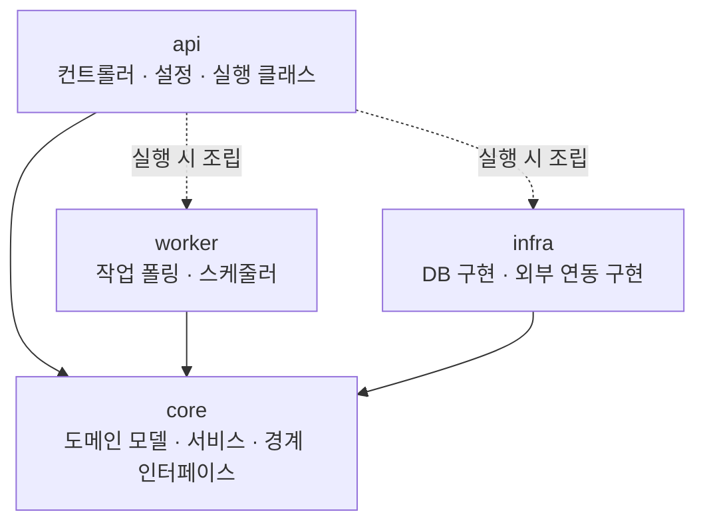
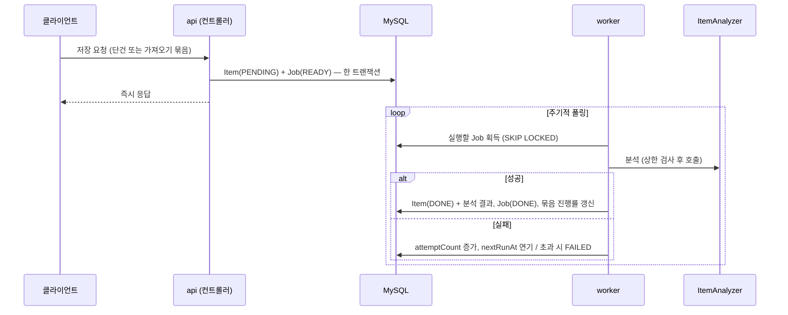

# 서버 아키텍처

| 항목 | 내용 |
| --- | --- |
| 범위 | 배포 구성, 모듈·패키지 구조, 도메인 모델, 확장 지점, 공통 규약 |
| 범위 밖 | 에이전트 작업 규칙([.claude/rules/](../.claude/rules/)), 테스트 전략([testing.md](testing.md)), 브랜치·커밋 규칙([conventions.md](conventions.md)), 빌드·배포([deployment.md](deployment.md)) |

> 이 문서는 "기획 방향(A/B안)이 정해지기 전에도 만들 수 있는 것"과 "정해진 뒤 갈아끼울 것"의 경계를 정한다.
> 확정된 내용은 [10. 결정 기록](#10-결정-기록)에, 아직 정하지 않은 내용은 [11. 남은 결정](#11-남은-결정)에 모았다. 본문의 `[제안]`은 남은 결정에 해당하는 부분이다.

---

## 1. 전제와 제약

- **서비스**: 저장만 하고 다시 쓰지 않는 정보를 "저장 → 다시 꺼내기 → 재사용"하게 만든다.
- **방향 미정** (11/14 POC 후 결정)
  - A안: 스크린샷을 가져와 정리하고, 쓸 만한 때 이유와 함께 먼저 꺼내 준다.
  - B안: 나에게 보낸 링크를 가져와 관심사를 해석하고, 목적이 생기면 내 저장물에서 찾아 묶어 준다.
- **일정·인력**: UT 11/28, 프리런칭 12월 중순. 서버 2명, 퇴근 후 작업.
- **규모**: 프리런칭 사용자 30명 이하. 이후 확장을 전제로 한다.
- **비용**: 서버·LLM 비용을 팀이 직접 부담한다. 서버는 최소 사양으로 시작한다.
- **핵심 지표**: 자발 재열람 (알림을 통하지 않고 검색·목록으로 다시 여는 것).
- **스택**: JDK 25, Kotlin 2.3, Spring Boot 4.1(Spring MVC, 가상 스레드), Gradle 9, MySQL, Swagger(springdoc). 추가 DB는 방향 확정 후 검토한다. 정확한 버전은 `gradle/libs.versions.toml`과 Gradle wrapper 설정이 원본이다.

## 2. 설계 원칙

1. **한 프로세스로 시작하고, 나눌 수 있게 만든다.** 실행 파일은 하나지만 코드는 모듈로 나눠, 배포 단위나 DB 기술이 늘어날 때 모듈 추가로 대응한다.
2. **방향이 바뀌어도 버리지 않는 코드.** A/B안에 따라 달라지는 부분은 경계 인터페이스 뒤에 둔다.
3. **개인정보 최소 수집.** 서버는 필요한 것만 받는다. 카톡 내보내기 파일은 클라이언트에서 링크만 추출해 전송하고, 원본 파일은 서버로 오지 않는다.
4. **비밀값은 환경변수로만.** 키·비밀번호·접속 문자열 실제값은 코드·설정·문서·커밋 어디에도 넣지 않는다. 저장소에는 `.env.example`(이름만)만 둔다.
5. **LLM 비용 통제.** 팀 공용 키를 쓰므로 모든 LLM 호출은 사용량 상한 검사를 거친다. 예상 비용은 서버보다 LLM 쪽이 크다.

## 3. 공통 부분과 가변 부분

| 영역 | 방향 무관 (지금 만든다) | A안일 때 | B안일 때 |
| --- | --- | --- | --- |
| 저장물 | 원본 참조, 요약, 주제, 처리 상태, 확장 칸 | 원본 = 이미지, 시간 단서(유효기간 등) | 원본 = 링크, 링크 메타데이터 |
| 가져오기 | 한 번의 가져오기를 묶는 단위, 진행률 | 스크린샷 일괄 업로드 | 링크 목록 일괄 등록 |
| 분석 | 작업 테이블 + 워커, 재시도, LLM 상한 | 비전 LLM 분석기 | 텍스트 LLM 분류기, 링크 본문 수집 |
| 꺼내기 | 목록·상세·키워드 검색, 열람 로그 | 쓸 때 알림 대상 선정, 바로 쓸 형태로 변환 | 관심사 집계·해석, 목적 기반 묶기 |
| 예약 작업 | 스케줄러 골격, 알림 발송 경계 | 저장한 날 저녁 정리 알림, 쓸 때 알림 | 주간 리포트 |
| 인증 | "현재 사용자" 추상화 | (방식 미정, 방향과 무관) | (동일) |

## 4. 배포 구성

- **한 프로세스**: API, 스케줄러, 워커가 같은 애플리케이션에서 돈다. 산출물은 컨테이너 이미지 1개다.
- **역할 켜고 끄기**: 워커와 스케줄러는 설정 플래그(`WORKER_ENABLED`, `SCHEDULER_ENABLED`)로 켜고 끈다. 같은 이미지를 컨테이너 두 개로 띄워 역할을 나누는 것이 코드 변경 없이 가능하다.
- **환경**: `local`(각자 PC, Docker Compose) / `dev`(개발 서버) / `prod`(운영 서버). 개발 서버를 먼저 띄우고 프리런칭 전에 운영 서버를 추가한다. 두 서버는 같은 이미지와 같은 Compose 파일을 쓰고 환경변수만 다르다.
- **배포 중 끊김 허용**: 무중단 배포는 하지 않는다. 배포로 중단된 작업은 작업 테이블의 회수 로직으로 복구한다.
- **DB 위치** `[제안]`: MySQL을 앱과 같은 서버에 컨테이너로 띄우고, 하루 한 번 덤프를 서버 밖에 보관한다. 관리형 DB는 서버 한 대 분의 비용이 더 든다.
- **서버가 2대 이상이 될 때**: 스케줄 작업이 중복 실행되므로 잠금 장치가 필요하다. 워커는 작업 획득 쿼리로 이미 중복을 막는다.

## 5. 모듈 구조



| 모듈 | 역할 | 의존 가능 대상 | 쓸 수 있는 기술 |
| --- | --- | --- | --- |
| `core` | 도메인 모델, 서비스, 경계 인터페이스 | 없음 | Spring의 DI·트랜잭션 어노테이션까지. JPA, 웹, HTTP 클라이언트, LLM SDK 금지 |
| `infra` | 경계 인터페이스의 구현. DB(`storage`)와 외부 연동(`external`)을 패키지로 나눈다 | `core` | JPA, MySQL 드라이버, Flyway, HTTP 클라이언트, LLM SDK, 푸시 SDK |
| `api` | 요청으로 시작하는 진입점(컨트롤러)과 설정. 실행 모듈 | `core` (코드에서), `infra`·`worker` (실행 시 조립만) | Spring MVC, springdoc, actuator |
| `worker` | 요청 없이 도는 진입점(작업 폴링, 스케줄러) | `core` | Spring의 스케줄링 |

- 화살표는 전부 `core`를 향한다. `core`의 서비스는 자기 안의 경계 인터페이스만 알고, 구현이 어떤 기술인지 모른다.
- `api`는 `infra`·`worker`를 Gradle `runtimeOnly`로 의존한다. 컨트롤러에서 JPA 엔티티나 LLM 클라이언트를 직접 쓰면 컴파일되지 않는다.
- 실행 파일은 `api` 하나다. `worker`는 `api`가 실행할 때 포함해 같은 프로세스에서 돈다.

**모듈 경계마다 컴파일러가 막아 주는 것**

| 경계 | 막는 것 |
| --- | --- |
| `core` ↔ `infra` | 서비스가 DB 기술, LLM SDK, HTTP 클라이언트를 직접 쓰는 것 |
| `api`·`worker` ↔ `infra` | 진입점이 서비스를 건너뛰고 구현을 직접 쓰는 것 |
| `api` ↔ `worker` | 컨트롤러와 워커가 서로의 코드를 부르는 것. 공유할 로직은 `core`의 서비스에 둔다 |

`infra` 안에서 저장소 구현과 외부 연동 구현이 서로를 부르는 것은 컴파일러가 막지 못한다. 코드 리뷰로 본다.

**확장할 때 하는 일**

| 생기는 일 | 하는 일 | 기존 코드 변경 |
| --- | --- | --- |
| DB 기술 추가 (캐시, 검색 등) | `infra`의 `storage`에 기술 패키지 추가 | `core`에 인터페이스 추가 |
| 워커·스케줄러를 따로 배포 | `worker`에 실행 클래스를 두고 실행 모듈로 전환 | 서비스는 `core`에, 워커 코드는 이미 `worker`에 있어 그대로 |
| 메시지 큐 도입 | `infra`의 `external`에 구현 추가 | `JobQueue` 구현체 교체 |
| A/B 방향 확정 | `infra`에 분석기 구현, `api`에 입력 컨트롤러 | `core`의 인터페이스는 그대로 |

## 6. 패키지 구조

기본 패키지는 `com.depromeet.team1`이다. `[제안]` 각 모듈 안에서는 기능 단위로 먼저 나눈다.

```
core        com.depromeet.team1.core
├── item/               저장물
│   ├── Item.kt, ItemStatus.kt …     도메인 모델 (프레임워크 어노테이션 없음)
│   ├── ItemService.kt               서비스 (업무 흐름, 트랜잭션 경계)
│   ├── ItemRepository.kt            경계 인터페이스
│   └── ItemError.kt                 기능별 에러 코드
├── intake/             가져오기 묶음
├── processing/         처리 작업, 분석기·작업 큐 인터페이스
├── retrieval/          꺼내기 (방향 확정 후 채움)
├── viewlog/            열람 로그
├── notification/       알림 발송 인터페이스
├── user/               사용자
├── llm/                LLM 호출 인터페이스, 사용량 상한
└── common/             공통 에러 타입, 공용 값

infra       com.depromeet.team1.infra
├── storage/mysql/
│   ├── item/           ItemJpaEntity, ItemJpaRepository(Spring Data), JpaItemRepository(구현), 변환 함수
│   ├── …               (core 의 기능 이름과 맞춘다)
│   └── config/         JPA 설정
├── external/
│   ├── llm/            LLM 클라이언트, 분석기 구현
│   ├── push/           푸시 발송 구현
│   └── file/           파일 저장소 구현
└── resources/db/migration/   Flyway 스크립트

api         com.depromeet.team1.api    (실행 클래스 ApiApplication 만 com.depromeet.team1 에 둔다)
├── web/<feature>/      컨트롤러, 요청·응답 DTO
├── web/common/         응답 포맷, 예외 변환, 현재 사용자 해석
└── config/             Swagger 등 설정

worker      com.depromeet.team1.worker
├── job/                작업 테이블 폴링, 작업 실행
└── schedule/           정해진 시각에 도는 작업
```

**작업 규칙**

패키지 배치, 호출, 도메인 모델, 서비스와 조회, 트랜잭션 규칙은 [.claude/rules/architecture.md](../.claude/rules/architecture.md)에 둔다. 에이전트가 매 작업에서 읽는 원본이다. 정한 이유는 10장에 있다.

모듈 간 의존은 컴파일러가 강제한다. 모듈 안의 규칙은 아키텍처 테스트(`api/src/test/kotlin/com/depromeet/team1/architecture/ArchitectureTest.kt`)가 `./gradlew build`에서 검사한다.

| 규칙 | 검사 |
| --- | --- |
| `core`에서 서비스가 아닌 클래스(도메인 모델, 경계 인터페이스)는 Spring에 의존하지 않는다 | 아키텍처 테스트 |
| `core`의 서비스는 `@Service`로 등록한다 | 아키텍처 테스트 |
| JPA 엔티티는 `infra`의 `storage` 패키지에 두고 이름을 `JpaEntity`로 끝낸다 | 아키텍처 테스트 |
| 컨트롤러는 `api`의 `web` 패키지에 두고 이름을 `Controller`로 끝낸다 | 아키텍처 테스트 |
| 예약 작업(`@Scheduled`)은 `worker`에 둔다 | 아키텍처 테스트 |
| 기능 간에는 상대 서비스를 호출하고 ID로 연결한다 | 코드 리뷰 |
| 외부 호출을 하는 서비스 메서드에 `@Transactional`을 붙이지 않는다 | 코드 리뷰 |

## 7. 도메인 모델

방향과 무관하게 필요한 최소 필드만 둔다. 컬럼 상세는 구현 단계에서 확정한다.

### Item (저장물)

| 필드 | 설명 |
| --- | --- |
| id, userId | 소유자 |
| importBatchId | 어느 가져오기에서 들어왔는지 (단건 추가는 null) |
| sourceType | `IMAGE` / `LINK` |
| sourceRef | 이미지면 저장소 키, 링크면 URL |
| title, summary | 분석 결과 (처리 전에는 null) |
| attributes | 방향별 추가 정보를 담는 JSON 확장 칸. 방향 확정 후 정식 컬럼으로 올린다 |
| status | `PENDING` → `PROCESSING` → `DONE` / `FAILED` |
| createdAt, processedAt | |

- **주제** `[제안]`: 별도 테이블 `item_topic(item_id, name)`. 사용자 단위 주제 집계를 SQL로 바로 할 수 있다.

### ImportBatch (가져오기 묶음)

| 필드 | 설명 |
| --- | --- |
| id, userId | |
| totalCount, doneCount, failedCount | 진행률과 첫 결과 화면의 근거 |
| createdAt, completedAt | |

### ProcessingJob (처리 작업)

| 필드 | 설명 |
| --- | --- |
| id, itemId, jobType | 어떤 저장물에 어떤 작업을 할지 |
| status | `READY` / `RUNNING` / `DONE` / `FAILED` |
| attemptCount, maxAttempts | 재시도 횟수 |
| nextRunAt | 다음 실행 시각 (재시도 시 뒤로 미룸) |
| lockedAt | 실행을 시작한 시각. 오래 `RUNNING`인 작업을 회수하는 기준 |
| lastError | 마지막 실패 사유 |

### ViewLog (열람 로그)

| 필드 | 설명 |
| --- | --- |
| id, userId, itemId | |
| entryPath | `NOTIFICATION` / `SEARCH` / `LIST` |
| viewedAt | |

- **자발 재열람** = `entryPath`가 `SEARCH` 또는 `LIST`인 열람. 지표 정의를 코드 한 곳에 둔다.

### User

- 최소 필드만 둔다. 로그인 수단은 인증 방식 확정 후 별도 테이블로 붙인다.

### LlmUsage (LLM 사용 기록)

- 호출 단위로 사용자·용도·토큰 수를 기록한다. 상한 검사의 근거 데이터다.

## 8. 확장 지점

### 경계 인터페이스

| 인터페이스 (`core`) | 역할 | 지금 넣는 구현 | 나중에 넣을 구현 |
| --- | --- | --- | --- |
| `XxxRepository` | 도메인 모델 저장·조회 | `infra`의 MySQL 구현 | 필요 시 다른 DB 구현 추가 |
| `ItemAnalyzer` | 저장물 → 요약·주제·추가 정보 | 고정값을 돌려주는 가짜 구현 | 비전 LLM(A) / 텍스트 LLM(B) |
| `LlmClient` | LLM 호출 | 인터페이스만 | 선택한 LLM 벤더 클라이언트 |
| `JobQueue` | 작업 등록·획득 | DB 작업 테이블 | 메시지 큐 |
| `FileStorage` | 이미지 저장·조회 | 인터페이스만 | Object Storage (A안) |
| `LinkContentFetcher` | 링크 본문·메타데이터 수집 | 인터페이스만 | HTTP 수집기 (B안) |
| `NotificationSender` | 푸시 발송 | 로그만 남기는 구현 | 푸시 서비스 |

- **LLM 사용량 상한**(`core`의 `LlmUsageGuard`): 호출 전에 검사한다. 가져오기 1회당 상한, 사용자별 일일 상한, 전체 일일 상한을 따로 둔다. 첫 가져오기에서 수백 건이 한 번에 들어오므로 일일 상한 하나로는 부족하다.
- **현재 사용자**: 컨트롤러는 "현재 사용자 ID"만 받는다. 해석 방법은 `api`의 한 곳에 두고 인증 방식이 정해지면 교체한다. 그 전에는 `local`·`dev`에서만 동작하는 헤더 방식을 쓴다.
- **꺼내기 유스케이스**: A안(알림 대상 선정)과 B안(관심사 집계·목적 기반 묶기)은 입출력 형태가 달라 하나의 인터페이스로 묶지 않는다. `retrieval` 패키지와 공통 의존(저장물 조회, 열람 로그 기록)만 준비하고, 방향 확정 후 서비스를 추가한다.

### 비동기 처리 흐름



- Item과 Job을 한 트랜잭션에 저장하므로 "저장됐는데 작업이 없는" 상태가 생기지 않는다.
- 작업 획득에 `SELECT ... FOR UPDATE SKIP LOCKED`를 써서 인스턴스가 늘어도 중복 처리하지 않는다.
- 워커의 동시 처리 수에 상한(`WORKER_CONCURRENCY`)을 둔다. API와 같은 프로세스에서 돌고 DB 커넥션을 나눠 쓰기 때문이다.
- 분석(LLM 호출)은 트랜잭션 밖에서 한다. 획득과 결과 저장이 각각 따로 커밋된다. ([.claude/rules/architecture.md](../.claude/rules/architecture.md)의 트랜잭션)
- 오래 `RUNNING`으로 남은 작업은 스케줄러가 `READY`로 되돌린다. (배포·장애로 중단된 작업 복구)
- **메시지 큐 교체 경계**: `JobQueue`의 등록은 발행으로, 워커의 폴링은 구독으로 바뀐다. 작업을 실제로 수행하는 서비스는 그대로 쓴다.

### 예약 작업

스케줄러는 `worker`에 두는 진입점이다. 시각이 되면 `core`의 서비스를 호출할 뿐, 로직을 갖지 않는다.

| 작업 | 시점 | 방향 |
| --- | --- | --- |
| 멈춘 작업 회수 | 수 분 간격 | 공통 |
| 저장한 날 저녁 정리 알림 | 매일 저녁 | A안 |
| 쓸 때 알림 (주말, 유효기간 임박 등) | 조건별 | A안 |
| 주간 리포트 | 주 1회 | B안 |

집계는 사용자 30명 × 수백 건 규모라 쿼리로 처리한다. 배치 프레임워크는 쓰지 않는다.

## 9. 공통 규약

- **API 경로**: `/api/v1/...`
- **응답 포맷** `[제안]`: HTTP 상태 코드를 그대로 쓰고, 본문은 아래 형태로 통일한다. 형식은 `api`의 `web/common`(`ApiResponse`, `ErrorResponse`)에 있다.
  - 성공: `{ "data": { ... } }`
  - 실패: `{ "code": "ITEM_NOT_FOUND", "message": "..." }`
- **에러 처리**
  - 도메인은 HTTP를 모른다. 에러 코드는 분류(`ErrorCategory`: `BAD_REQUEST`, `NOT_FOUND`, `CONFLICT`, `INTERNAL`)만 가지고, HTTP 상태는 `api`가 분류를 보고 정한다. 분류는 쓸 곳이 생길 때 추가한다(인증, 외부 연동 실패 등).
  - 에러 코드는 `ErrorCode`를 구현한 기능별 enum으로 `core`의 해당 기능 패키지에 둔다. 응답의 `code`는 enum 이름이고, 기능 간 겹치지 않게 기능 이름으로 시작한다 (예: `ITEM_NOT_FOUND`). 공통 코드는 `core/common/error/CommonError`.
  - 서비스는 `AppException(에러 코드, 상세)`를 던진다.
  - 응답 메시지는 에러 코드에 정의된 문구만 쓴다. 상세 사유는 로그에만 남긴다.
  - 변환은 `api`의 `GlobalExceptionHandler` 한 곳에서 한다. 500대 응답은 ERROR, 나머지는 WARN으로 기록한다. 모니터링을 붙이면 ERROR를 알림 기준으로 삼는다.
- **API 문서**: springdoc으로 `/swagger-ui.html`에 생성하되 참고용이다. API 규격을 무엇으로 관리할지는 정하지 않았다(11장). `prod` 프로필에서는 꺼 둔다.
- **상태 확인**: actuator의 `/actuator/health`만 연다. 배포 후 확인과 외부 상태 점검에 쓴다. 힙 덤프·환경변수 같은 엔드포인트는 비밀값이 드러날 수 있어 열지 않는다.
- **로그**: LLM에 보낸 내용과 받은 응답 원문, 사용자가 저장한 내용은 로그에 남기지 않는다. 저장물·작업 번호만 남긴다.
- **테스트**: 계층별 방식과 규칙은 [docs/testing.md](testing.md)에 둔다.
- **스키마 관리**: Flyway. 애플리케이션은 스키마를 만들지 않는다(`ddl-auto: validate`).
- **시간**: UTC 저장, 응답은 ISO-8601
- **프로필과 환경변수**: `local` / `dev` / `prod`. 목록과 주입 방법은 [docs/deployment.md](deployment.md)에 둔다. 값은 코드·설정·문서에 넣지 않는다.

## 10. 결정 기록

| 결정 | 이유 |
| --- | --- |
| API·스케줄러·워커를 한 프로세스로 | 서버 비용이 메모리 크기로 정해진다. 프로세스를 나누면 서버 등급이 올라가는데 30명 규모에서 얻는 것이 없다. 역할 플래그로 나중에 나눌 수 있다 |
| 배포 중 끊김 허용 | 무중단 배포의 복잡도를 감수할 규모가 아니다. 중단된 작업은 회수 로직으로 복구한다 |
| 환경은 local / dev / prod | 개발 서버를 먼저 두고 프리런칭 전에 운영 서버를 추가한다 |
| 멀티모듈 4개 (`core`, `infra`, `api`, `worker`) | 지키려는 규칙을 컴파일러가 강제하게 한다. 코드 대부분을 에이전트가 쓰므로, 문서로만 둔 규칙보다 컴파일 오류가 확실하다 |
| 화살표가 `core`를 향하는 의존 방향 | `core`가 DB 모듈을 알면 DB 기술을 더하거나 바꿀 때 `core`를 고쳐야 한다 |
| DB와 외부 연동 구현을 `infra` 한 모듈에 패키지로 구분 | 둘 다 "`core`의 경계 인터페이스를 구현한다"는 같은 역할이다. 모듈을 나눠 얻는 것은 둘이 서로를 부르지 못하게 하는 것뿐인데, 2명 규모에서는 코드 리뷰로 충분하다 |
| 워커·스케줄러를 `worker` 모듈로 분리, 실행은 `api`와 한 프로세스 | 컨트롤러와 워커가 서로의 코드를 부르지 못하게 하고, 나중에 따로 배포할 때 옮길 코드가 없게 한다. 프로세스를 나누지 않는 이유는 서버 비용이다 |
| 헥사고날 구조를 전부 따르지 않음 | 의존 방향을 안쪽으로 모으는 것과 바깥 경계의 인터페이스는 가져온다. 서비스마다 두는 입력 인터페이스, 유스케이스별 클래스, 계층마다의 모델 변환은 가져오지 않는다. 구현이 하나뿐인 인터페이스와 변환 코드는 2명·3개월 일정에서 비용만 든다 |
| Spring MVC + 가상 스레드, WebFlux 미사용 | JPA가 블로킹이라 WebFlux의 이점을 얻기 어렵고, 오래 걸리는 LLM 호출은 워커가 요청 밖에서 처리한다. 응답을 기다리는 동안 스레드를 잡는 문제는 가상 스레드로 푼다 |
| 트랜잭션은 서비스의 `@Transactional`, 외부 호출이 낀 흐름은 저장소 메서드 단위 커밋 | 함께 저장할 일이 많은 요청 처리에서는 묶는 쪽이 기본이어야 실수가 적다. 외부 호출을 기다리는 동안 DB 커넥션을 잡지 않으려고 그 흐름만 끊는다 |
| 서비스 테스트는 직접 만든 가짜 구현으로, 쿼리는 실제 MySQL로 | 목은 구현을 그대로 따라 적기 쉬워 틀린 코드도 통과시킨다. 쿼리는 실행해 봐야 검증된다. 상세는 [testing.md](testing.md) |
| 상태 변경 규칙은 도메인 모델의 메서드에, 조회 전용 화면은 조회 모델로 | 전이 규칙이 서비스에 흩어지면 검사가 빠지기 쉽다. 반대로 보여 주기만 하는 조회까지 도메인 모델을 만들었다가 바꾸는 것은 비용만 든다 |
| 서비스는 기능당 하나로 시작 | 조회용·변경용 분리의 이점(읽기 전용 DB 분리, 큰 파일 나누기)이 지금은 없다. 커지면 나눈다 |
| 서비스 인터페이스를 두지 않음 | 구현이 하나뿐인 인터페이스는 코드만 늘린다. 바깥 기술과 닿는 경계에만 인터페이스를 둔다 |
| 도메인 모델과 JPA 엔티티 분리 | `core`가 DB 기술을 모르게 하려면 필요하다. 비용은 변환 코드 |
| 스케줄러는 `worker`의 진입점, 배치 프레임워크 미사용 | 예약 작업은 필요하지만 규모상 `@Scheduled`와 쿼리로 충분하다 |
| JDK 25 + Spring Boot 4.1 + Kotlin 2.3 + Gradle 9 | 시작 시점의 최신 LTS JDK와 최신 안정 버전이다. Kotlin은 2.3부터 JDK 25를 지원한다. 서버는 컨테이너로 실행하므로 JDK 버전이 클라우드 선택에 영향을 주지 않는다 |
| 기본 패키지는 `com.depromeet.team1` | 패키지명은 바꾸는 비용이 크다. 서비스명과 무관한 이름으로 고정하고, 서비스명은 문서 제목과 애플리케이션 이름에만 쓴다 |
| 실행 모듈 이름은 `api` | 배포 단위는 주된 역할로 이름 짓는다 |
| 로컬 DB는 Docker Compose, 테스트 DB는 Testcontainers | 로컬과 테스트 모두 운영과 같은 MySQL로 돌려, H2 같은 대체 DB와의 문법 차이를 없앤다 |
| 비동기 처리는 DB 작업 테이블 + 워커 | 추가 인프라 없이 재시도·복구가 가능하다. 메시지 큐는 `JobQueue` 뒤에서 교체한다 |
| 가져오기 묶음과 예약 알림을 공통 뼈대에 포함 | 두 방향 모두 첫 진입에서 수백 건을 한 번에 가져오고, 정해진 시각에 알림을 보낸다 |

## 11. 남은 결정

| # | 항목 | 제안 | 누구와 / 언제 |
| --- | --- | --- | --- |
| 1 | MySQL 위치 | 앱과 같은 서버에 컨테이너 + 일 1회 덤프 | 서버 |
| 2 | 모듈 안 패키지 배치 | 기능 우선 (6장) | 서버 |
| 3 | 주제 저장 형태 | `item_topic` 별도 테이블 | 서버 |
| 4 | 응답 포맷 | 9장 형태로 구현해 두었다. 웹팀 확인 후 확정 | 서버 + 웹 |
| 5 | API 규격 관리 방식 | 문서로 관리하고 Swagger는 참고용으로 두는 안. 웹·디자인과 함께 쓰는 에이전트용 레포를 만들지와 같이 정한다 | 팀 / 다음 회의 |
| 6 | 열람 진입 경로 전달 방식 | 상세 조회 파라미터 | 서버 + 웹 |
| 7 | 인증 방식 | 미정 | 서버 + 웹 + 기획 |
| 8 | 클라우드 | 미정 | 크레딧 지원 여부 확인 후 |
| 9 | LLM 벤더와 예산 | 미정 | 팀 |
| 10 | 추가 DB | MySQL로 가능한지 먼저 검토 | 11/14 방향 확정 후 |
| 11 | 스크린샷 원본 보관 기간·삭제 정책 | 개인정보가 담길 수 있어 정책 필요 | A안 확정 시 |
| 12 | 링크 본문 수집 방식 | 차단 사이트 처리, 내부망 주소 호출 방지 필요 | B안 확정 시 |
| 13 | 꺼내기 서비스 형태 | — | 11/14 방향 확정 후 |

## 12. 지금 넣지 않는 것

| 항목 | 넣지 않는 이유 | 도입 시점·확장 지점 |
| --- | --- | --- |
| 메시지 큐 | 현재 규모에 불필요, 비용 미확인 | 프리런칭 이후. `JobQueue` 구현 교체 |
| 추가 DB (캐시, 검색, 벡터) | 방향 미확정. 하나 늘 때마다 서버 메모리가 는다 | 방향 확정 후. `infra`의 `storage`에 패키지 추가 |
| 워커·스케줄러 분리 배포 | 서버 비용 | 부하가 생기면. `worker`를 실행 모듈로 전환 |
| 스케줄 중복 실행 잠금 | 환경마다 서버가 1대 | 서버를 2대 이상으로 늘릴 때 |
| 정적 분석 (detekt) | 안정 버전(1.x)이 JDK 25에서 실행되지 않는다. 포맷 검사는 ktlint로 한다 | detekt 2.0 정식 출시 후 |
| 커버리지 수치 기준 | 수치를 채우려는 테스트만 늘어난다 | 도입하지 않는다. 테스트 규칙은 [testing.md](testing.md) |
| 무중단 배포, 인프라 코드화, APM | 최소 구성 원칙 | 여유가 생기면 |

## 13. 인프라 전제

클라우드는 정해지지 않았다. 애플리케이션은 아래만 전제하고 어느 클라우드든 맞출 수 있게 한다.

- 산출물은 컨테이너 이미지 1개
- 설정은 전부 환경변수 주입
- 외부 의존은 MySQL 1대
- 서버 한 대에 앱 컨테이너와 MySQL 컨테이너를 함께 올릴 수 있는 메모리(2GB 이상)

빌드 명령, 서버 구축, 배포 절차는 별도 문서(`docs/deployment.md`)에 정리한다.

## 14. 기능 하나를 만드는 순서

안쪽(`core`)에서 바깥쪽으로 작업한다. 파일 이름은 저장물(Item)을 예로 든 것이다.

| 순서 | 모듈 | 만드는 것 | 위치 |
| --- | --- | --- | --- |
| 1 | `core` | 도메인 모델. 프레임워크 어노테이션 없이 규칙과 상태 변경을 담는다 | `core/item/Item.kt` |
| 2 | `core` | 경계 인터페이스, 서비스, 에러 코드 | `core/item/ItemRepository.kt`, `ItemService.kt`, `ItemError.kt` |
| 3 | `core` | 가짜 구현과 서비스 테스트. Spring 없이 서비스를 조립한다 | `core/src/testFixtures`, `core/src/test` |
| 4 | `infra` | JPA 엔티티, 인터페이스 구현, 변환 함수, Flyway 스크립트 | `infra/storage/mysql/item/`, `resources/db/migration/` |
| 5 | `infra` | 저장소 테스트. 실제 MySQL에서 쿼리를 실행한다 | `infra/src/test` |
| 6 | `api` | 컨트롤러, 요청·응답 DTO, 컨트롤러 테스트 | `api/web/item/` |
| 7 | `worker` | 비동기 작업이 있을 때만. 작업을 가져와 서비스를 호출한다 | `worker/job/` |

- 1~3이 끝나면 DB 없이도 업무 로직이 검증된 상태다. 테이블 설계는 4에서 사람의 확인을 받고 진행한다.
- 단계마다 따르는 규칙은 `.claude/rules/`의 해당 파일에 있다.

실제 코드 예시는 저장물(Item) 구현이 끝나면 이 장에 그 코드의 위치를 적는다.
