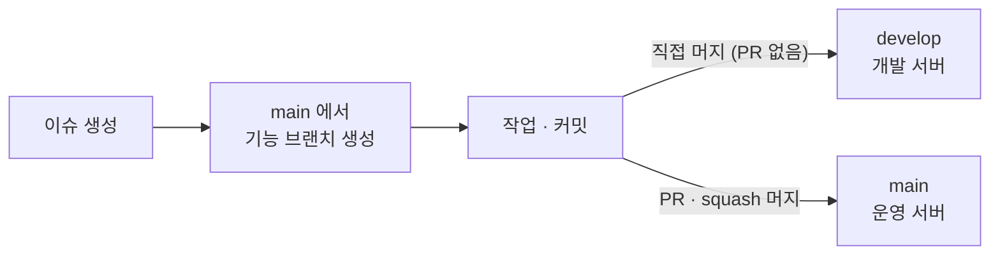
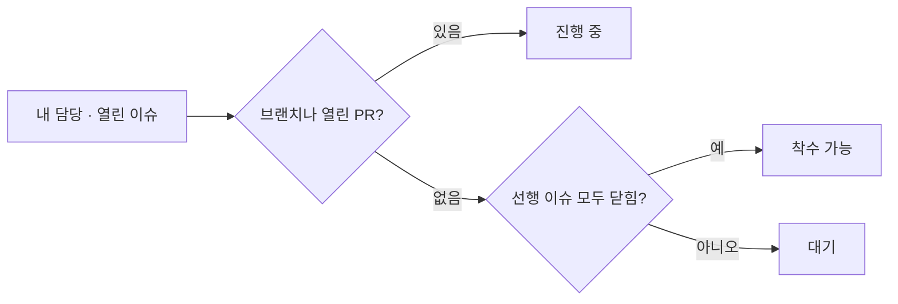

# 브랜치·커밋·PR 규칙

일감은 GitHub 이슈로, 변경은 PR로 관리한다. 이슈 번호가 브랜치·커밋·PR을 잇는다.

## 1. 작업 흐름



1. **이슈**를 만든다. 할 일 하나에 이슈 하나.
2. **`main`에서** 기능 브랜치를 만든다.
3. 작업하고 커밋한다.
4. 개발 서버에서 확인이 필요하면 기능 브랜치를 **`develop`에 직접 머지**해 푸시한다.
5. 완료되면 **`main`으로 PR**을 올리고, 리뷰와 검사를 거쳐 **squash 머지**한다.

## 2. 브랜치

| 브랜치 | 역할 | 들어오는 방법 | 배포 |
| --- | --- | --- | --- |
| `main` | 운영에 나가는 코드 | 기능 브랜치의 PR을 squash 머지. 직접 푸시 금지 | 운영 서버 |
| `develop` | 여러 기능을 합쳐 개발 서버에서 확인하는 곳 | 기능 브랜치를 로컬에서 머지해 푸시. PR 없음 | 개발 서버 |
| 기능 브랜치 | 이슈 하나의 작업 | — | — |

**기능 브랜치 이름**: `타입/이슈번호-영문-설명` (예: `feat/12-item-save`, `fix/31-job-order`)

**지켜야 할 것**

- 기능 브랜치는 항상 `main`에서 만든다. `develop`에서 만들지 않는다.
- `develop`을 기능 브랜치에 머지하지 않는다. 다른 사람의 미완성 작업이 내 PR에 섞여 `main`으로 들어간다.
- `develop`에 머지할 때 난 충돌은 `develop`에서 해결한다. 기능 브랜치로 가져와 풀지 않는다.
- `develop`은 `main`으로 머지하지 않는다. `main`으로 가는 길은 기능 브랜치의 PR 하나뿐이다.
- `develop`이 `main`과 많이 벌어지거나 꼬이면, 둘이 합의한 뒤 `main` 기준으로 다시 맞춘다.

## 3. 커밋 메시지와 PR 제목

둘 다 같은 형식을 쓴다.

```
타입(모듈): 설명 (#이슈번호)
```

```
feat(core, api): 저장물 등록 API 추가 (#12)
fix(infra): 작업 획득 쿼리 정렬 누락 수정 (#31)
docs: 아키텍처 문서에 인증 방식 반영 (#8)
```

| 요소 | 규칙 |
| --- | --- |
| 타입 | 아래 표의 여섯 가지 중 하나 |
| 모듈 | `core`, `infra`, `api`, `worker` 중 영향받는 것. 여러 개면 `, `로 나열. 영향받는 모듈이 없으면(문서, 빌드 설정 등) 생략 |
| 설명 | 한국어, 마침표 없이, 무엇을 했는지 |
| 이슈 번호 | 필수. 커밋은 훅이 브랜치 이름에서 읽어 자동으로 붙인다 |

| 타입 | 쓰는 때 |
| --- | --- |
| `feat` | 기능 추가 |
| `fix` | 버그 수정 |
| `refactor` | 동작 변화 없는 구조 변경 |
| `docs` | 문서 |
| `test` | 테스트만 추가·수정 |
| `chore` | 빌드, 설정, 의존성 |

squash 머지하면 PR 제목이 `main`의 커밋 메시지가 된다. `main` 이력은 PR 제목으로 읽힌다.

**커밋 본문**

- 제목만으로 충분하면 본문은 생략한다.
- 쓸 때는 "왜 바꿨는지"를 짧게 적는다. 무엇을 바꿨는지는 diff에 있으므로 나열하지 않는다.
- 여러 기능을 건드렸으면 기능 단위로 한 줄씩 적는다.

## 4. PR

- 대상 브랜치는 `main`이다.
- 본문에 `Closes #이슈번호`를 적는다. 머지되면 이슈가 자동으로 닫힌다. 이슈를 닫지 않는 PR은 `Refs #이슈번호`를 적는다. `Closes`로 닫는 이슈의 스토리 파일(`docs/plan/stories/`)은 그 PR에서 지운다.
- 이슈·PR을 열면 담당자가 비어 있을 때 작성자가 담당자로 자동 지정된다(`Auto assign` 워크플로). PR 리뷰어는 `.github/CODEOWNERS`에 따라 자동으로 요청된다.
- 검사(`ci-result`, `convention`)가 통과하면 squash 머지한다. 리뷰 승인은 아직 필수로 걸지 않았다.
- 머지된 기능 브랜치는 삭제한다.

### 본문 작성

PR 본문은 리뷰어가 처음 읽고 바로 이해할 수 있게 쓴다. 절 구성은 `.github/PULL_REQUEST_TEMPLATE.md`를 따른다.

| 절 | 쓰는 방법 |
| --- | --- |
| 요약 | 무엇을 왜 바꿨는지 두 문장 이내. 이것만 읽어도 PR이 이해돼야 한다. 바로 아래에 `Closes #이슈번호` |
| 변경 내용 | 3~5줄을 기준으로, 파일·클래스 목록이 아니라 동작이나 결정 단위로 적는다. 이슈에 있는 배경(무엇을·왜)은 다시 쓰지 않는다 |
| 확인 방법 | 실행한 명령과 결과. 실행하지 못한 검증은 못 했다고 적는다 |
| 리뷰어에게 | 사람의 판단이 필요한 것만 적는다. 없으면 절을 지운다 |

- **개조식으로 짧게**: 문장 대신 한 줄 항목으로 쓰고 "~함", "~추가"처럼 끝낸다. 존댓말(~해요, ~합니다)과 수식어를 쓰지 않는다. 리뷰어가 훑어서 바로 핵심을 잡게 한다.
- **사람 말로**: 레포 밖 사람이 모를 약어와 내부 용어는 풀어 쓴다.
- **복잡한 건 그림으로**: 흐름, 구조, 상태 변화, 여러 단계의 순서처럼 글로 쓰면 길어지는 내용은 Mermaid 그림 하나로 보여 준다. GitHub는 PR 본문의 Mermaid를 그림으로 보여 준다.
- **길이**: 화면 한 장을 넘으면 줄이거나, 부가 설명은 `<details>`로 접는다.

**예시**

````markdown
## 요약
다음 일감 고를 때 브랜치·열린 PR이 있는 스토리는 제외. 여러 세션이 같은 일감을 다시 집는 것 방지.

Closes #38

## 변경 내용
- 브랜치·열린 PR 있는 스토리 → "진행 중"으로 분리, 후보에서 제외
- 원격 조회 실패 시 로컬 목록으로 대체, 그것도 실패하면 이 검사만 건너뜀



## 확인 방법
- `scripts/claude/test-next-story.sh` → 모두 통과
- 실제 레포에서 실행 → 열린 PR 있는 #38이 "진행 중"에 나옴
````

## 5. 에이전트로 작성한 커밋

에이전트(Claude 등)가 작성한 커밋에는 메시지 끝에 아래 한 줄을 남긴다.

```
Co-Authored-By: Claude <noreply@anthropic.com>
```

세션 링크나 세션 식별 정보는 커밋·PR에 남기지 않는다.

에이전트는 커밋하기 전에 메시지를 사람에게 보여 주고 확인을 받는다. 이슈 생성, 푸시, PR 생성도 사람이 요청할 때만 한다.

## 6. 검사

규칙은 문서로만 두지 않고 자동 검사로 강제한다. 타입·모듈 목록과 형식의 원본은 `scripts/check-convention.sh`이고, 아래 검사가 모두 이 스크립트를 쓴다. 규칙을 바꾸면 스크립트와 이 문서를 같은 PR에서 고친다.

| 시점 | 검사 | 우회 가능 여부 |
| --- | --- | --- |
| 커밋할 때: `pre-commit` 훅 | 스테이지된 Kotlin 파일을 ktlint로 포맷해 커밋에 포함한다 | `--no-verify`로 건너뛸 수 있다 |
| 커밋할 때: `commit-msg` 훅 | 브랜치 이름에서 이슈 번호를 읽어 메시지에 붙이고, 형식이 틀리면 커밋을 거부한다 | `--no-verify`로 건너뛸 수 있다 |
| Claude Code가 커밋할 때: 커밋 직전 훅(`.claude/settings.json`) | 문서 검사(`scripts/check-docs.sh`). 실패하면 커밋을 막는다 | 세션을 시작한 폴더만 검사한다. 다른 워크트리에서 한 커밋은 검사하지 않는다 |
| 푸시할 때: `pre-push` 훅 | 문서 검사(`scripts/check-docs.sh`): 문서 안 상대 링크, roadmap 이슈 번호, 지운 표기, 코드에서 쓰는 환경변수가 `docs/deployment.md` 표와 `.env.example`에 있는지 | `--no-verify`로 건너뛸 수 있다 |
| PR을 올리거나 수정할 때: `Convention` 워크플로 | PR 제목, 브랜치 이름, PR에 든 커밋 메시지, PR 본문(`Closes`·`Refs`, 닫는 이슈의 스토리 파일)을 검사한다 | 통과해야 머지할 수 있다 |
| 기능 브랜치·`develop`에 푸시할 때: `CI` 워크플로 | 바뀐 모듈과 그 모듈에 의존하는 모듈의 테스트, 구조 테스트, 포맷 검사 ([ci.md](ci.md)), 문서 검사 | 머지를 막지 않는다. `develop`은 통과해야 이미지를 올린다 |
| `main`에 푸시될 때(머지 후): `CI` 워크플로 | `./gradlew ktlintCheck build` (포맷 검사, 전체 테스트), 문서 검사 | 통과해야 이미지를 올린다 |
| `main` 대상 PR을 올리거나 수정할 때: `CI` 워크플로 | `./gradlew ktlintCheck build` (포맷 검사, 전체 테스트), 문서 검사. 결과는 `ci-result` 검사 하나로 모인다 | 통과해야 머지할 수 있다 |
| 머지할 때: 브랜치 규칙 | `main`은 PR과 두 검사 통과가 있어야 하고 squash 머지만 허용한다. 직접 푸시, 강제 푸시, 삭제는 막혀 있다 | 불가 |

훅은 레포의 `scripts/git-hooks/`와 ktlint 플러그인이 제공하고, 로컬에서 `./gradlew`로 처음 빌드할 때 `.git/hooks`에 자동으로 설치된다. `Merge`, `Revert`, `fixup!`처럼 git이 만드는 메시지는 검사하지 않는다.
