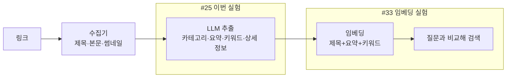

# 저장물 분석 LLM 모델 비교

저장물 하나에서 카테고리·요약·키워드·카테고리별 상세 정보를 어느 모델이 가장 잘 뽑는지, 플랫폼(수집 수준)별로 어떤 정보까지 뽑히는지 보는 실험이다. 분석기(`ItemAnalyzer`)에 쓸 모델을 고르는 근거가 된다.

> 상태: **실험 전.** 실험 도구와 링크 세트만 있다. 카테고리와 상세 정보는 디자인팀 초안(확정 전)이고, 평가 기준과 모델 후보는 팀 확인 전 제안이다. 결과 표는 실제로 돌린 수치만 채우고, 돌리지 못한 모델은 그 이유를 적는다.

## 실험 위치



키워드(주제어)는 홈 관심사 카드를 묶는 기준이고 임베딩의 재료다. 여기서 품질이 낮으면 #33 검색도 떨어진다. 같은 링크 세트를 #33에서도 쓴다.

## 1. 추출하는 데이터

### 공통

| 값 | 채우는 곳 |
| --- | --- |
| 원본 URL, 제목, 저장일, 썸네일 | 수집기. LLM이 뽑지 않는다. 이 실험에서는 제목만 입력으로 쓴다 |
| 카테고리 1개 | LLM |
| 두 번째 후보 카테고리(`alt_category`) | LLM. 분류가 애매할 때만, 아니면 빈 값. 디자인 질문 (3-3)용 |
| 핵심 요약(주제) | LLM. 두 문장 이내 |
| 키워드 3~5개 | LLM |
| 카테고리별 상세 정보 | LLM. 아래 표 |

### 카테고리별 상세 정보 (디자인팀 초안, 확정 전)

LLM은 고른 카테고리의 필드만 채운다. 주어진 정보에 근거가 없으면 비워 두고 추측하지 않는다. 유형 필드는 아래 선택지 중 하나를 고른다.

| 카테고리 | 필드 (키) | 선택지 |
| --- | --- | --- |
| 맛집·장소 | 장소명(`place_name`), 위치(`location`), 장소 유형(`place_type`) | 장소 유형: 식당, 카페, 관광지, 기타 |
| 제품·쇼핑 | 제품명(`product_name`), 제품 유형(`product_type`), 브랜드명(`brand`) | 모두 자유 텍스트 |
| 레시피·생활 | 활용 유형(`usage_type`) | 요리, 청소, 정리·수납, 세탁, 수리·관리, 건강·생활, 기타 |
| 업무·학습 | 자료 유형(`material_type`) | 가이드, 템플릿, 강의, 기타 |
| 콘텐츠·아티클 | 콘텐츠 유형(`content_type`) | 기사, 영상, 블로그, 기타 |
| 디자인·아이디어 | 레퍼런스 유형(`reference_type`) | UI, 그래픽, 브랜딩, 기타 |
| 쿠폰·티켓·기프티콘 | 혜택(이벤트)명(`benefit_name`), 유형(`benefit_type`), 유효기간(`valid_until`) | 유형: 쿠폰, 티켓, 기프티콘 |
| 기타 | 없음 (공통 데이터만) | — |

- 선택지는 디자인팀 초안의 예시다. "기타" 선택지는 예시 밖 값을 받으려고 실험에서 붙였다(혜택 유형 제외).
- 카테고리 설명은 업무·학습, 콘텐츠·아티클만 디자인팀 문장이고, 나머지는 실험용 보조 설명이다. 원본은 `scripts/llm-eval/config.json`.

## 2. 이 실험이 답하는 것 (디자인팀 질문)

| 질문 | 보는 결과 |
| --- | --- |
| (2) 링크에서 추출할 수 있는 정보의 범위 | 카테고리 × 필드 × 수집 수준 표의 추출률 |
| (3-2) 카테고리별 데이터 중 확보가 어렵거나 정확성을 챙기기 힘든 것 | 같은 표의 추출률이 낮은 필드, 정확도가 낮거나 헛채움률이 높은 필드 |
| (3-3) 여러 카테고리에 걸치거나 분류가 불확실할 때의 처리 | `alt_category`를 낸 비율, 정답과 다르게 분류한 사례, 틀렸을 때 두 번째 후보가 정답인 비율 |
| (추가) 분류 기준을 주제로 할지, 저장한 사람이 나중에 할 일로 할지. 같은 링크도 사용자 직군에 따라 쓰임이 다를 수 있다(예: 디자이너에게 L23은 디자인 자료) | 이 실험은 "할 일" 기준으로 정답을 정했다. 디자인팀에 확인한다 |

## 3. 조건

| 항목 | 내용 |
| --- | --- |
| 입력 | 텍스트만. 썸네일 이미지는 넣지 않는다 |
| 링크 세트 | [llm-evaluation/links.csv](llm-evaluation/links.csv), 50개. 카테고리마다 4개 이상, 수집 수준이 섞이게 고른다. 정답 라벨은 사람이 단다 |
| 정답 라벨 열 | `label_category`, `label_keywords`(`;`로 구분), 상세 정보는 `label_<필드 키>`(예: `label_place_name`). 정답 카테고리의 필드만 채우고, 링크에 근거가 없으면 비운다 |
| 분류 기준 | 저장한 사람이 나중에 이 링크로 할 일로 고른다: 가 본다 → 맛집·장소, 산다 → 제품·쇼핑, 생활에서 따라 한다 → 레시피·생활, 일·공부에 쓴다 → 업무·학습, 참고 이미지로 본다 → 디자인·아이디어, 기한 있는 혜택을 쓴다 → 쿠폰·티켓·기프티콘, 읽거나 보고 끝 → 콘텐츠·아티클, 다시 꺼낼 일이 없다 → 기타. 할 일이 있는 카테고리를 우선하고, 제목보다 실제 내용을 따른다. 정답은 모델 입력이 아니라 링크의 실제 내용 기준이다. 프롬프트와 카테고리 설명(`config.json`의 `hint`)도 이 기준에 맞췄다 |
| 출력 | 위 1절의 값. 제공자의 JSON 스키마 출력 기능을 쓴다 |
| 프롬프트 | 모든 모델이 같은 프롬프트를 쓴다. 원본은 `scripts/llm-eval/eval.py`의 `system_prompt`, `user_prompt` |
| 본문 길이 | 링크 본문은 앞 6,000자까지만 넣는다(`body_max_chars`). 잘린 링크는 입력 캐시에 `body_truncated`로 남는다 |

**수집 수준별 입력** ([scope.md](plan/scope.md) "플랫폼별 수집 수준". 약관 결정(결정 대기 1)에 따라 바뀔 수 있다)

| 수준 | 플랫폼 | 모델에 주는 것 |
| --- | --- | --- |
| 자동 정리 | 유튜브 | oEmbed(제목, 채널) + `YOUTUBE_API_KEY`가 있으면 Data API의 설명 전체·태그. 영상 페이지의 OG·HTML은 약관상 쓰지 않는다 |
| 자동 정리 | 블로그·뉴스, 네이버 블로그, 노션 공개 페이지 | OG 제목·설명 + 본문 텍스트. 네이버 블로그는 모바일 주소(`m.blog.naver.com`)로 바꿔 가져온다 |
| 부분 자동 | X, 핀터레스트 | 공식 oEmbed(제목, 작성자, X는 글 본문). 핀터레스트 주소는 `/pin/<숫자>/`로 바꿔 요청한다 |
| 링크 + 메모 | 인스타그램, 쇼핑몰 | URL만 |

사용자 메모는 기획에 없어 넣지 않는다. `links.csv`의 `memo` 열은 비워 두며, 스크립트는 값이 있을 때만 입력에 넣는다. 수준 이름은 [scope.md](plan/scope.md)와 맞춰 두었고, scope.md의 메모 항목 정리는 `plan-sync`에서 한다.

요청 UA는 봇이라고 밝힌 `link-eval-bot`이다. 노션 공개 페이지는 봇 UA에만 본문을 준다. 다른 서비스의 봇 이름은 쓰지 않는다. 플랫폼별 수집 근거는 11/19 수집 조사 자료를 따른다.

## 4. 평가 기준 (제안)

| 지표 | 계산 |
| --- | --- |
| 카테고리 정확도 | 정답 카테고리와 같은 비율. 정답 라벨이 없는 링크는 뺀다. 수집 수준별로도 본다 |
| 키워드 재현율 | 정답 핵심 주제어 중 모델 키워드와 겹치는 비율. 공백·기호를 지우고 한쪽이 다른 쪽을 포함하면 맞은 것으로 본다. 동의어는 못 잡으므로 사람이 확인한다 |
| 요약 | 자동 채점하지 않는다. 사람이 `out/review-<모델>.csv`의 `summary_score`에 1~5점을 매긴다 |
| 상세 정보 추출률 | 필드마다, 정답이 있는 링크 중 모델이 값을 채운 비율 |
| 상세 정보 정확도 | 필드마다, 정답이 있는 링크 중 정답과 같은 값을 채운 비율. 비교는 공백·기호만 무시한다. 자유 텍스트 필드는 review CSV에서 사람이 확인한다 |
| 상세 정보 헛채움률 | 필드마다, 정답이 빈 링크 중 모델이 값을 채운 비율. 근거 없이 추측한 정도 |
| 분류 애매함 | `alt_category`를 낸 비율, 정답과 다른 사례 목록, 틀린 것 중 두 번째 후보가 정답인 수 |
| 형식 오류 | JSON이 아니거나, 목록·선택지 밖 값, 빈 요약·키워드, 빠진 필드 |
| 토큰·비용 | 응답의 사용량 값 × 아래 단가. 단가를 확인하지 못한 모델은 비용을 비워 둔다 |

상세 정보는 **정답 카테고리의 필드만** 채점한다. 모델이 카테고리를 틀리면 그 링크의 정답 필드는 대개 비어서 추출률이 같이 떨어진다.

## 5. 모델 후보와 단가 (제안)

| 모델 | 제공자 | 키 환경변수 | 입력 / 출력 (USD, 100만 토큰당) | 단가 출처 |
| --- | --- | --- | --- | --- |
| `claude-haiku-5-5` | Anthropic | `ANTHROPIC_API_KEY` | 0.10 / 0.50 (입력 10만 토큰 이하) | Anthropic 모델 표(2026-11-03 기준). 실행 전 재확인 |
| `claude-sonnet-5-5` | Anthropic | `ANTHROPIC_API_KEY` | 2.00 / 10.00 | 위와 같음 |
| `gpt-5.4-nano` | OpenAI | `OPENAI_API_KEY` | 미확인 | 공식 단가표에서 확인 후 채운다 |
| `gpt-5.4-mini` | OpenAI | `OPENAI_API_KEY` | 미확인 | 위와 같음 |
| `gemini-3.5-flash-lite` | Google | `GEMINI_API_KEY` | 미확인 | 위와 같음 |
| `gemini-3.8-flash` | Google | `GEMINI_API_KEY` | 미확인 | 2026년 말까지 프로모션 단가라는 자료가 있다. 비교는 정가로 한다 |

OpenAI·Google 모델 ID는 검색으로 찾은 후보다. 실행 전에 각 회사의 모델 목록에서 더 새 모델이 있는지 확인한다.

## 6. 실행 방법

스크립트는 `scripts/llm-eval/`에 있고 빌드·CI 테스트 대상이 아니다([ci.md](ci.md) 2절). 키는 셸 환경변수로 넣고, 스크립트는 값을 출력하지 않는다.

```bash
cd scripts/llm-eval
python3 -m unittest test_eval.py          # 키 없이 도는 시험 (입력 만들기, 형식 검사, 채점)
python3 -m venv .venv && . .venv/bin/activate && pip install -r requirements.txt
python3 eval.py keys                      # 비어 있는 키 환경변수 이름을 알려 준다
python3 eval.py fetch                     # 링크마다 입력을 만들어 .cache/에 저장 (YOUTUBE_API_KEY가 있으면 유튜브 설명 포함)
python3 eval.py run --models claude-haiku-5-5,claude-sonnet-5-5
python3 eval.py score                     # 결과 표 출력, 사람이 볼 out/review-<모델>.csv 저장
```

- `.cache/`(링크 본문)와 `out/`(모델 응답, review CSV)은 커밋하지 않는다. 링크 본문은 저장하지 않는다는 원칙([scope.md](plan/scope.md))을 실험에도 적용한다.
- 키가 없는 모델이 하나라도 있으면 `run`은 실행하지 않고 끝난다. `--models`로 키가 있는 모델만 고른다.
- `run`은 이전 결과(`out/<모델>.jsonl`)에서 API 오류가 난 링크와 결과가 없는 링크만 부른다. 처음부터 다시 부르려면 `--fresh`를 붙인다. 결과는 한 건마다 저장하므로 중간에 멈춰도 그때까지의 결과가 남는다.
- 요청 한도(429)나 제공자 쪽 일시 과부하(503, 529)가 나면 제공자가 알려 준 대기 시간(없으면 60초, 최대 120초)만큼 기다렸다가 링크당 5번까지 다시 부른다. 그래도 실패하면 API 오류로 남기고 다음 링크로 간다.

**입력 수집 확인** (`fetch`, 2026-11-21): 50개 모두 입력을 받았다. 유튜브는 `YOUTUBE_API_KEY` 없이 돌려 제목·채널만 받았다. 핀터레스트 oEmbed와 YES24 티켓은 가끔 403·차단 페이지를 돌려줘서, 실패한 링크는 다시 돌린다.

**Gemini 호출 확인** (`gemini-3.5-flash-lite`, 무료 등급, 2026-11-21): 형식 오류 없이 응답을 받았다. 무료 등급은 모델별 분당 요청 한도(`GenerateRequestsPerMinutePerProjectPerModel-FreeTier`)가 있어, 쉬지 않고 부르면 21건 뒤부터 429가 났다.

**확인하지 못한 것**: OpenAI(`responses.create`) 호출 코드는 처음 돌릴 때 SDK 문서와 맞는지 확인한다. Data API로 유튜브 설명을 받는 부분도 키를 넣고 확인하지 않았다.

## 7. 결과

2026-11-21, 무료 등급 Gemini만 돌렸다. Claude·OpenAI는 키가 없어 돌리지 않았고, 단가가 확인되지 않아 비용 칸은 비어 있다. 정답 라벨은 3절의 분류 기준으로 정했다.

**gemini-3.5-flash-lite** (링크 50개, 현재 프롬프트)

| 지표 | 값 |
| --- | --- |
| 성공 / 형식 오류 / API 오류 | 48 / 2 / 0 |
| 카테고리 정확도 | 67% (32/48) |
| 수집 수준별 정확도 | 자동 정리 68% (19/28), 부분 자동 73% (8/11), 링크 + 메모(URL만) 56% (5/9) |
| 주제어 재현율 | 56% (100/179) |
| 틀린 16건 중 두 번째 후보가 정답 | 6건 |
| 토큰 (입력 / 출력, 50건 합계) | 66,371 / 10,502 |
| 평균 지연 | 2.1초 |

- **형식 오류 2건**(L40, L41)은 URL만 들어가는 인스타그램 링크다. 근거가 없어 요약과 주제어를 비웠다. 지어내지 말라는 지시를 따른 결과라 오류라기보다 "링크만으로는 분석할 수 없음"으로 본다.
- **자주 틀린 방향**: 할 일이 있는 링크를 콘텐츠·아티클로 고른다(L20 디자인 글, L29 신제품, L35 인테리어 핀, L42 이벤트). 날씨처럼 다시 꺼낼 일이 없는 링크도 콘텐츠·아티클로 고른다(L07, L18, L31). URL만 있는 링크는 기타로 고른다(L43~L45).
- **프롬프트 비교**: 같은 정답 라벨로 이전 프롬프트(주제·활용 목적)는 70% (35/50)였다. 분류 기준을 "나중에 할 일"로 바꾼 프롬프트에서 나아지지 않았다. 50건으로는 차이를 말하기 어렵다.
- **상세 정보**: 선택형 필드는 자동 정리 수준에서 대체로 맞는다(활용 유형 3/3, 콘텐츠 유형 7/9). 링크 + 메모 수준은 URL만 들어가 근거가 없어 거의 비어 있다(제품명 0/3, 혜택명 0/5). 위치·혜택명 같은 자유 텍스트는 자동 비교가 엄격해 정확도가 낮게 나오므로 `out/review-<모델>.csv`로 사람이 확인해야 한다(아직 하지 않았다).

**gemini-3.8-flash**: 무료 등급에서 한 건에 2~11분이 걸리고 503(과부하)이 잦아 50건을 끝내지 못했다. 돌린 12건은 이전 프롬프트 결과라 위 표와 비교하지 않는다. 유료 등급의 응답 시간은 확인하지 않았다.

## 8. 모델 제안

파트에서 결정한다. 지금 근거로 제안하는 것은 다음과 같다.

- **바로 쓸 수 있는 후보는 `gemini-3.5-flash-lite`다.** 50건 중 48건을 형식 오류 없이 처리했고(나머지 2건은 근거 없는 링크), 평균 지연은 2.1초였다. 다만 카테고리 정확도가 67%라, 분류 결과를 그대로 확정하기보다 두 번째 후보를 함께 보여 주거나 사용자가 고칠 수 있어야 한다(디자인 질문 3-3).
- **모델을 확정하기 전에 볼 것**: `gemini-3.8-flash` 50건(덜 붐빌 때), Claude·OpenAI 모델(유료. Claude는 5절 단가로 50건에 1달러 안쪽, OpenAI는 단가 미확인), 각 모델의 유료 단가. 이 비교는 후속 작업으로 둔다.
- **모델보다 먼저 정할 것**: 분류 기준(주제 / 할 일, 직군별 차이)과 링크만 저장되는 플랫폼의 처리(메모 없이는 분석할 근거가 없다). 둘 다 디자인팀 확인이 필요하다.

## 9. 임베딩 검색 (#33)

채팅에서 질문으로 저장물을 찾을 때, 무엇을 임베딩해야 상위 5개 안에 찾는 저장물이 들어오는지 보는 실험이다. 채팅 검색 방식과 임베딩 대상(결정 대기 9, [scope.md](plan/scope.md))을 정하는 근거가 된다.

> 상태: **실행 완료(2026-11-21).** 질문·정답과 채점 규칙은 실행 전에 확정했고, 결과를 본 뒤 바꾸지 않았다. 8개 조합 모두 통과(적중 10/10)했다. 제안은 아래 "제안"에 있고, 결정은 결정 대기 9에서 한다.

### 조건

| 항목 | 내용 |
| --- | --- |
| 임베딩 모델 | `gemini-embedding-2`, 무료 등급. [단가표](https://aistudio.google.com/docs/pricing)(2026-11-21 확인)에서 무료 등급 텍스트 입력이 "Free of charge"다. 무료 등급은 입력이 제품 개선에 쓰이므로 공개 링크의 요약과 직접 쓴 질문만 보낸다 |
| 검색 대상 | 링크 세트 50개의 `gemini-3.5-flash-lite` 결과(7절). 요약·주제어와 수집한 제목을 [llm-evaluation/embedding-docs.csv](llm-evaluation/embedding-docs.csv)로 고정했다. 요약이 빈 L40, L41은 뺀다(48개). 링크 + 메모 수준(L40~L50)은 요약에 내용이 거의 없어 정답에 넣지 않았지만, 헛걸리는지 보려고 검색 대상에는 남겼다 |
| 임베딩 대상 | 요약만: `title: none \| text: {요약}`. 제목+요약+주제어: `title: {제목} \| text: {요약} 주제어: {주제어, …}`(제목이 없으면 `title: none`) |
| 질문 | [llm-evaluation/embedding-queries.csv](llm-evaluation/embedding-queries.csv). 정답이 있는 질문 10개와 '관련 없음' 질문 3개. 질문마다 검색어 말투와 채팅 말투 두 가지다. 문장은 `task: search result \| query: {질문}` |
| 접두어 | `gemini-embedding-2`는 `task_type` 대신 문장 앞 접두어로 용도를 알린다([임베딩 문서](https://aistudio.google.com/docs/embeddings) "Task types with Embeddings 2"). 위 형식은 그 문서의 검색용 형식이다 |
| 출력 차원 | 768, 3072(기본값). 저장 크기를 정하는 근거로 둘 다 받는다. 768차원 응답이 3072차원 응답의 앞 768개를 정규화한 것과 같은지도 확인한다 |
| 유사도 | 코사인 |

### 채점 규칙 (실행 전에 확정)

| 지표 | 계산 |
| --- | --- |
| 적중 | 상위 5개 안에 정답 저장물이 하나라도 있으면 적중이다. 적중률 = 적중 질문 수 / 10 |
| 통과 | 적중 8/10 이상. 기준값을 적용하기 전 적중률로 판정한다 |
| 정답 재현율 | 질문마다 상위 5개 안에 든 정답 수 / 정답 수. 표에는 10개 질문의 평균 |
| 첫 정답 순위 | 전체 순위에서 처음 나온 정답의 순위 |
| 정답 최저 유사도 | 질문의 정답들 중 가장 낮은 유사도(전체 순위 기준). 관련 없음 질문의 1위 유사도와 나란히 본다 |
| 관련 없음 기준값 T | 조합(차원 × 임베딩 대상 × 말투)마다, 관련 없음 질문 3개가 받은 1위 유사도 중 가장 큰 값 |
| T 적용 뒤 적중 | 유사도가 T 이하인 결과를 버린 뒤에도 상위 5개 안에 정답이 남은 질문 수 |

질문 3개로 정한 T는 참고값이다. 운영 기준값으로 확정하지 않는다.

**저장 크기** (벡터 값만, float32 4바이트 기준): 768차원은 3,072바이트(3KB), 3072차원은 12,288바이트(12KB)다. DB 저장 형식에 따른 추가 크기는 포함하지 않았다.

### 실행 방법

```bash
cd scripts/llm-eval
python3 -m unittest test_embed_eval.py    # 키 없이 도는 시험 (문장 만들기, 채점, 기준값, 캐시)
python3 embed_eval.py snapshot            # #25 결과(.cache/, out/)로 embedding-docs.csv를 다시 만든다. 커밋된 파일이 있으면 필요 없다
python3 embed_eval.py run                 # GEMINI_API_KEY 필요. 768·3072차원 임베딩을 받아 .cache/embeddings/에 저장
python3 embed_eval.py score               # 결과 표 출력, out/embedding-detail.csv 저장
```

- 문장은 120개다. 검색 대상 문장은 48개 × 임베딩 대상 2가지인데, L44와 L45는 문장이 같아 대상마다 하나로 쳐서 94개다. 여기에 질문 문장 26개(13개 × 말투 2가지)를 더한다. 50개씩 묶어 차원마다 3번, 모두 6번 부른다. 문장마다 `Content`를 따로 넣는다. 한 `Content`에 여러 문장을 넣으면 벡터 하나로 합쳐진다([임베딩 문서](https://aistudio.google.com/docs/embeddings) "Embedding aggregation").
- 받은 벡터는 묶음마다 저장하고, 다시 실행하면 없는 문장만 부른다. 429·503이 나면 `eval.py`와 같은 방식으로 기다렸다가 다시 부른다.
- 무료 등급의 임베딩 요청 한도는 공식 문서에서 확인하지 못했다. 실행 기록은 아래 결과에 있다.

### 결과

**실행 기록** (2026-11-21, 무료 등급): 768·3072차원 모두 문장 120개를 받았고, 호출은 6번이다. 실행 중 요청 한도(429)가 3번 났고, 기다렸다가 다시 불러 모두 받았다. 어느 한도(분당·하루)에 걸렸는지는 기록하지 않았다. 비용은 없다.

**조합별 결과** (검색 대상 48개)

| 차원 | 임베딩 대상 | 질문 말투 | 적중 (상위 5) | 평균 정답 재현율 | 기준값 T | T 적용 뒤 적중 | T를 넘는 정답 | 관련 없음 1위 저장물 |
| --- | --- | --- | --- | --- | --- | --- | --- | --- |
| 768 | 요약만 | 검색어 | 10/10 | 93% | 0.604 | 10/10 | 23/23 | L42, L44, L44 |
| 768 | 요약만 | 채팅 | 10/10 | 80% | 0.649 | 10/10 | 18/23 | L46, L44, L46 |
| 768 | 제목+요약+주제어 | 검색어 | 10/10 | 97% | 0.586 | 10/10 | 23/23 | L09, L44, L44 |
| 768 | 제목+요약+주제어 | 채팅 | 10/10 | 88% | 0.622 | 10/10 | 23/23 | L46, L43, L43 |
| 3072 | 요약만 | 검색어 | 10/10 | 93% | 0.590 | 10/10 | 23/23 | L09, L44, L42 |
| 3072 | 요약만 | 채팅 | 10/10 | 85% | 0.639 | 10/10 | 18/23 | L46, L44, L46 |
| 3072 | 제목+요약+주제어 | 검색어 | 10/10 | 97% | 0.571 | 10/10 | 23/23 | L09, L44, L03 |
| 3072 | 제목+요약+주제어 | 채팅 | 10/10 | 95% | 0.610 | 10/10 | 23/23 | L46, L43, L46 |

- 통과 판정: 8개 조합 모두 적중 10/10으로 통과다. 첫 정답이 거의 모두 1위로 나와(80개 중 77개, 나머지 3개는 2위) 적중률로는 조합 차이가 드러나지 않는다. 차이는 정답 재현율에서 보인다.
- **임베딩 대상**: 제목+요약+주제어가 모든 차원·말투에서 요약만보다 재현율이 같거나 높다(93→97%, 80→88%, 93→97%, 85→95%).
- **말투**: 채팅 말투가 검색어 말투보다 재현율이 낮다(97% → 88~95%, 제목+요약+주제어 기준). 기준값 T도 0.04 정도 올라간다. "저장해 둔 거" 같은 말이 내용 없는 저장물과 가까워지는 것으로 보인다(아래 "내용 없는 저장물").
- **차원**: 적중은 같다. 재현율은 채팅 말투에서만 3072가 높다(요약만 80% → 85%, 제목+요약+주제어 88% → 95%). 제목+요약+주제어의 차이는 정답 2개(Q03의 L25, Q09의 L35)다. 검색어 말투는 같다.
- **768과 3072의 관계**: 768차원 응답은 3072차원 응답의 앞 768개를 정규화한 것과 같았다(문장 120개, 최저 코사인 1.000000). 3072로 받아 두면 나중에 768로 줄여 쓸 수 있고, 768로 받으면 3072로 되돌릴 수 없다(다시 임베딩해야 한다).
- **기준값 T**: 검색어 말투 0.571~0.604, 채팅 말투 0.610~0.649. 요약만·채팅은 T가 정답보다 높아져 정답 23개 중 5개가 잘린다. 제목+요약+주제어는 모든 조합에서 정답 23개가 모두 T를 넘는다. 다만 1위 정답과 T의 차이는 가장 작을 때 0.05 정도다(768차원 Q03 0.677 대 0.622, 3072차원 0.052).

**질문별 정답 재현율** (상위 5개 안에 든 정답 수 / 정답 수, 괄호는 첫 정답 순위가 1위가 아닐 때. 요약 = 요약만, 전체 = 제목+요약+주제어, 검 = 검색어, 채 = 채팅)

| 질문 | 정답 | 768 요약 검 | 768 요약 채 | 768 전체 검 | 768 전체 채 | 3072 요약 검 | 3072 요약 채 | 3072 전체 검 | 3072 전체 채 |
| --- | --- | --- | --- | --- | --- | --- | --- | --- | --- |
| Q01 | L04, L17, L33 | 3/3 | 3/3 | 3/3 | 3/3 | 3/3 | 3/3 | 3/3 | 3/3 |
| Q02 | L02, L11, L32 | 3/3 | 3/3 | 3/3 | 3/3 | 3/3 | 3/3 | 3/3 | 3/3 |
| Q03 | L39, L22, L25 | 2/3 | 2/3 | 2/3 | 2/3 | 2/3 | 2/3 | 2/3 | 3/3 |
| Q04 | L07, L18, L31 | 3/3 | 3/3 | 3/3 | 3/3 | 3/3 | 3/3 | 3/3 | 3/3 |
| Q05 | L08, L19 | 2/2 | 1/2 (2위) | 2/2 | 1/2 | 2/2 | 1/2 (2위) | 2/2 | 1/2 |
| Q06 | L01 | 1/1 | 1/1 | 1/1 | 1/1 | 1/1 | 1/1 | 1/1 | 1/1 |
| Q07 | L27 | 1/1 | 1/1 | 1/1 | 1/1 | 1/1 | 1/1 | 1/1 | 1/1 |
| Q08 | L05, L30 | 2/2 | 1/2 | 2/2 | 2/2 | 2/2 | 2/2 | 2/2 | 2/2 |
| Q09 | L35, L36, L37 | 2/3 | 1/3 | 3/3 | 2/3 | 2/3 | 1/3 | 3/3 | 3/3 |
| Q10 | L14, L34 | 2/2 | 2/2 (2위) | 2/2 | 2/2 | 2/2 | 2/2 | 2/2 | 2/2 |

**768차원 · 제목+요약+주제어 · 채팅** (T=0.622)

| 질문 | 정답 재현율 | 첫 정답 순위 | 정답 최저 유사도 | T | 상위 5개 |
| --- | --- | --- | --- | --- | --- |
| Q01 | 3/3 | 1 | 0.712 | 0.622 | L04 0.736, L17 0.723, L33 0.712, L42 0.645, L06 0.621 |
| Q02 | 3/3 | 1 | 0.695 | 0.622 | L32 0.721, L11 0.700, L02 0.695, L49 0.648, L46 0.647 |
| Q03 | 2/3 | 1 | 0.639 | 0.622 | L39 0.677, L22 0.666, L44 0.650, L45 0.650, L32 0.648 |
| Q04 | 3/3 | 1 | 0.640 | 0.622 | L07 0.688, L18 0.668, L31 0.640, L42 0.603, L43 0.602 |
| Q05 | 1/2 | 1 | 0.630 | 0.622 | L19 0.684, L46 0.678, L43 0.659, L44 0.646, L45 0.646 |
| Q06 | 1/1 | 1 | 0.701 | 0.622 | L01 0.701, L17 0.628, L04 0.617, L33 0.614, L43 0.608 |
| Q07 | 1/1 | 1 | 0.727 | 0.622 | L27 0.727, L20 0.649, L25 0.602, L43 0.600, L44 0.597 |
| Q08 | 2/2 | 1 | 0.654 | 0.622 | L30 0.678, L49 0.660, L05 0.654, L11 0.649, L43 0.644 |
| Q09 | 2/3 | 1 | 0.649 | 0.622 | L36 0.729, L44 0.667, L45 0.667, L43 0.661, L37 0.660 |
| Q10 | 2/2 | 1 | 0.684 | 0.622 | L14 0.687, L34 0.684, L46 0.674, L49 0.663, L48 0.634 |
| N01 (관련 없음) | — | — | — | 1위 0.622 | L46 0.622, L49 0.597, L43 0.584, L42 0.578, L44 0.577 |
| N02 (관련 없음) | — | — | — | 1위 0.610 | L43 0.610, L44 0.606, L45 0.606, L49 0.575, L42 0.574 |
| N03 (관련 없음) | — | — | — | 1위 0.620 | L43 0.620, L46 0.617, L44 0.613, L45 0.613, L49 0.596 |

**3072차원 · 제목+요약+주제어 · 채팅** (T=0.610)

| 질문 | 정답 재현율 | 첫 정답 순위 | 정답 최저 유사도 | T | 상위 5개 |
| --- | --- | --- | --- | --- | --- |
| Q01 | 3/3 | 1 | 0.702 | 0.610 | L04 0.727, L17 0.707, L33 0.702, L42 0.641, L46 0.611 |
| Q02 | 3/3 | 1 | 0.679 | 0.610 | L32 0.705, L02 0.685, L11 0.679, L46 0.637, L49 0.630 |
| Q03 | 3/3 | 1 | 0.629 | 0.610 | L39 0.661, L22 0.651, L25 0.629, L32 0.627, L43 0.626 |
| Q04 | 3/3 | 1 | 0.635 | 0.610 | L07 0.676, L18 0.652, L31 0.635, L46 0.589, L43 0.589 |
| Q05 | 1/2 | 1 | 0.615 | 0.610 | L19 0.676, L46 0.669, L43 0.640, L44 0.626, L45 0.626 |
| Q06 | 1/1 | 1 | 0.682 | 0.610 | L01 0.682, L17 0.621, L46 0.605, L04 0.603, L43 0.601 |
| Q07 | 1/1 | 1 | 0.714 | 0.610 | L27 0.714, L20 0.627, L25 0.589, L43 0.586, L46 0.583 |
| Q08 | 2/2 | 1 | 0.648 | 0.610 | L30 0.665, L05 0.648, L49 0.636, L46 0.634, L11 0.631 |
| Q09 | 3/3 | 1 | 0.631 | 0.610 | L36 0.724, L37 0.652, L44 0.633, L45 0.633, L35 0.631 |
| Q10 | 2/2 | 1 | 0.677 | 0.610 | L34 0.685, L14 0.677, L46 0.669, L49 0.643, L48 0.630 |
| N01 (관련 없음) | — | — | — | 1위 0.608 | L46 0.608, L49 0.572, L43 0.571, L50 0.566, L44 0.564 |
| N02 (관련 없음) | — | — | — | 1위 0.591 | L43 0.591, L44 0.586, L45 0.586, L42 0.561, L49 0.557 |
| N03 (관련 없음) | — | — | — | 1위 0.610 | L46 0.610, L43 0.606, L44 0.597, L45 0.597, L49 0.583 |

질문별 상세(8개 조합 모두)는 `python3 embed_eval.py score`가 `scripts/llm-eval/out/embedding-detail.csv`로 저장한다(커밋하지 않음).

**내용 없는 저장물** (채점 규칙 밖의 추가 관찰): 관련 없음 질문의 1위와 정답을 상위 5개에서 밀어낸 저장물은 대부분 링크 + 메모 수준(L42~L50)이다. 요약이 "인스타그램 게시물 링크입니다", "나중에 구매하기 위해 저장한 제품 정보이다"처럼 내용이 없어 어느 질문과도 비슷하게 가깝다. 이 수준(L40~L50)을 검색 대상에서 빼고 같은 질문으로 다시 계산하면 다음과 같다(검색 대상 39개, 새로 부르지 않고 같은 벡터로 계산).

| 차원 | 임베딩 대상 | 질문 말투 | 적중 (상위 5) | 평균 정답 재현율 | 기준값 T | T 적용 뒤 적중 | T를 넘는 정답 | 관련 없음 1위 저장물 |
| --- | --- | --- | --- | --- | --- | --- | --- | --- |
| 768 | 요약만 | 검색어 | 10/10 | 97% | 0.601 | 10/10 | 23/23 | L09, L07, L03 |
| 768 | 요약만 | 채팅 | 10/10 | 100% | 0.589 | 10/10 | 23/23 | L09, L32, L01 |
| 768 | 제목+요약+주제어 | 검색어 | 10/10 | 97% | 0.586 | 10/10 | 23/23 | L09, L07, L26 |
| 768 | 제목+요약+주제어 | 채팅 | 10/10 | 100% | 0.583 | 10/10 | 23/23 | L09, L33, L27 |
| 3072 | 요약만 | 검색어 | 10/10 | 97% | 0.590 | 10/10 | 23/23 | L09, L07, L03 |
| 3072 | 요약만 | 채팅 | 10/10 | 100% | 0.578 | 10/10 | 23/23 | L09, L32, L27 |
| 3072 | 제목+요약+주제어 | 검색어 | 10/10 | 97% | 0.571 | 10/10 | 23/23 | L09, L29, L03 |
| 3072 | 제목+요약+주제어 | 채팅 | 10/10 | 100% | 0.577 | 10/10 | 23/23 | L26, L13, L27 |

- 채팅 말투 재현율이 88~95%에서 100%로 오르고, 채팅 말투의 T가 0.610~0.649에서 0.577~0.589로 내려간다. 말투와 차원의 차이가 거의 사라진다.
- 검색 대상을 바꾼 계산이라 통과 판정에는 쓰지 않는다.

### 제안

결정 대기 9(채팅 검색 대상)에서 정한다. 지금 근거로 제안하는 것은 다음과 같다.

- **임베딩 대상은 제목+요약+주제어로 한다.** 모든 조합에서 재현율이 같거나 높고, 기준값을 적용해도 정답이 잘리지 않았다.
- **차원은 768로 저장한다.** 적중은 같고, 재현율 차이(채팅 88% / 95%)는 정답 2개이며 내용 없는 저장물을 빼면 사라진다. 저장 크기는 3072의 4분의 1(3KB / 12KB)이다. 768은 3072의 앞부분과 같으므로 API에 768을 바로 요청하면 된다. 나중에 3072가 필요해지면 다시 임베딩한다(유료 단가 100만 토큰당 $0.20).
- **내용 없는 저장물은 임베딩하지 않는다.** 링크 + 메모 수준처럼 요약에 내용이 없는 저장물이 관련 없는 질문의 1위를 차지하고 정답을 밀어냈다. 이런 저장물은 채팅 검색 대상에서 빼고 목록·키워드 검색으로만 찾게 하는 방안을 결정 대기 9에서 함께 정한다. 사용자 메모를 받게 되면 메모를 임베딩해 다시 잰다.
- **관련 없음 기준값은 잠정 0.62로 둔다**(768차원, 제목+요약+주제어, 채팅, 전체 검색 대상). 내용 없는 저장물을 빼면 0.58이다. 질문 3개로 정한 값이고 정답과의 차이가 0.05 정도라, 운영 전에 관련 없음 질문을 늘려 다시 잰다.
- **이 실험의 한계**: 검색 대상 50개, 질문 10개로 작다. 첫 정답이 거의 모두 1위로 나와 적중률은 쉬운 기준이었다. 실제 사용자 데이터는 저장물이 많고 주제가 겹치므로, 저장물이 쌓이면 같은 도구로 다시 잰다.
