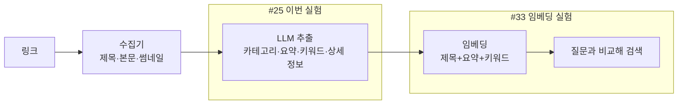

# 저장물 분석 LLM 모델 비교

저장물 하나에서 카테고리·요약·키워드·카테고리별 상세 정보를 어느 모델이 가장 잘 뽑는지, 플랫폼(수집 수준)별로 어떤 정보까지 뽑히는지 보는 실험이다. 분석기(`ItemAnalyzer`)에 쓸 모델을 고르는 근거가 된다.

> 상태: **실험 전.** 실험 도구와 링크 세트만 있다. 카테고리와 상세 정보는 디자인팀 초안(확정 전)이고, 평가 기준과 모델 후보는 팀 확인 전 제안이다. 결과 표는 실제로 돌린 수치만 채우고, 돌리지 못한 모델은 그 이유를 적는다.

## 실험 위치



키워드(주제어)는 홈 관심사 카드를 묶는 기준이고 임베딩의 재료다. 여기서 품질이 낮으면 #33 검색도 떨어진다. 같은 링크 세트를 #33에서도 쓴다.

## 1. 추출하는 데이터

### 공통

| 값 | 채우는 곳 |
| --- | --- |
| 원본 URL, 제목, 저장일, 썸네일 | 수집기. LLM이 뽑지 않는다. 이 실험에서는 제목만 입력으로 쓴다 |
| 카테고리 1개 | LLM |
| 두 번째 후보 카테고리(`alt_category`) | LLM. 분류가 애매할 때만, 아니면 빈 값. 디자인 질문 (3-3)용 |
| 핵심 요약(주제) | LLM. 두 문장 이내 |
| 키워드 3~5개 | LLM |
| 카테고리별 상세 정보 | LLM. 아래 표 |

### 카테고리별 상세 정보 (디자인팀 초안, 확정 전)

LLM은 고른 카테고리의 필드만 채운다. 주어진 정보에 근거가 없으면 비워 두고 추측하지 않는다. 유형 필드는 아래 선택지 중 하나를 고른다.

| 카테고리 | 필드 (키) | 선택지 |
| --- | --- | --- |
| 맛집·장소 | 장소명(`place_name`), 위치(`location`), 장소 유형(`place_type`) | 장소 유형: 식당, 카페, 관광지, 기타 |
| 제품·쇼핑 | 제품명(`product_name`), 제품 유형(`product_type`), 브랜드명(`brand`) | 모두 자유 텍스트 |
| 레시피·생활 | 활용 유형(`usage_type`) | 요리, 청소, 정리·수납, 세탁, 수리·관리, 건강·생활, 기타 |
| 업무·학습 | 자료 유형(`material_type`) | 가이드, 템플릿, 강의, 기타 |
| 콘텐츠·아티클 | 콘텐츠 유형(`content_type`) | 기사, 영상, 블로그, 기타 |
| 디자인·아이디어 | 레퍼런스 유형(`reference_type`) | UI, 그래픽, 브랜딩, 기타 |
| 쿠폰·티켓·기프티콘 | 혜택(이벤트)명(`benefit_name`), 유형(`benefit_type`), 유효기간(`valid_until`) | 유형: 쿠폰, 티켓, 기프티콘 |
| 기타 | 없음 (공통 데이터만) | — |

- 선택지는 디자인팀 초안의 예시다. "기타" 선택지는 예시 밖 값을 받으려고 실험에서 붙였다(혜택 유형 제외).
- 카테고리 설명은 업무·학습, 콘텐츠·아티클만 디자인팀 문장이고, 나머지는 실험용 보조 설명이다. 원본은 `scripts/llm-eval/config.json`.

## 2. 이 실험이 답하는 것 (디자인팀 질문)

| 질문 | 보는 결과 |
| --- | --- |
| (2) 링크에서 추출할 수 있는 정보의 범위 | 카테고리 × 필드 × 수집 수준 표의 추출률 |
| (3-2) 카테고리별 데이터 중 확보가 어렵거나 정확성을 챙기기 힘든 것 | 같은 표의 추출률이 낮은 필드, 정확도가 낮거나 헛채움률이 높은 필드 |
| (3-3) 여러 카테고리에 걸치거나 분류가 불확실할 때의 처리 | `alt_category`를 낸 비율, 정답과 다르게 분류한 사례, 틀렸을 때 두 번째 후보가 정답인 비율 |

## 3. 조건

| 항목 | 내용 |
| --- | --- |
| 입력 | 텍스트만. 썸네일 이미지는 넣지 않는다 |
| 링크 세트 | [llm-evaluation/links.csv](llm-evaluation/links.csv), 50개. 카테고리마다 4개 이상, 수집 수준이 섞이게 고른다. 정답 라벨은 사람이 단다 |
| 정답 라벨 열 | `label_category`, `label_keywords`(`;`로 구분), 상세 정보는 `label_<필드 키>`(예: `label_place_name`). 정답 카테고리의 필드만 채우고, 링크에 근거가 없으면 비운다 |
| 출력 | 위 1절의 값. 제공자의 JSON 스키마 출력 기능을 쓴다 |
| 프롬프트 | 모든 모델이 같은 프롬프트를 쓴다. 원본은 `scripts/llm-eval/eval.py`의 `system_prompt`, `user_prompt` |
| 본문 길이 | 링크 본문은 앞 6,000자까지만 넣는다(`body_max_chars`). 잘린 링크는 입력 캐시에 `body_truncated`로 남는다 |

**수집 수준별 입력** ([scope.md](plan/scope.md) "플랫폼별 수집 수준". 약관 결정(결정 대기 1)에 따라 바뀔 수 있다)

| 수준 | 플랫폼 | 모델에 주는 것 |
| --- | --- | --- |
| 자동 정리 | 유튜브 | oEmbed(제목, 채널) + `YOUTUBE_API_KEY`가 있으면 Data API의 설명 전체·태그. 영상 페이지의 OG·HTML은 약관상 쓰지 않는다 |
| 자동 정리 | 블로그·뉴스, 네이버 블로그, 노션 공개 페이지 | OG 제목·설명 + 본문 텍스트. 네이버 블로그는 모바일 주소(`m.blog.naver.com`)로 바꿔 가져온다 |
| 부분 자동 | X, 핀터레스트 | 공식 oEmbed(제목, 작성자, X는 글 본문) + 사람이 쓴 메모. 핀터레스트 주소는 `/pin/<숫자>/`로 바꿔 요청한다 |
| 링크 + 메모 | 인스타그램, 쇼핑몰 | URL + 사람이 쓴 메모 한 줄 |

요청 UA는 봇이라고 밝힌 `link-eval-bot`이다. 노션 공개 페이지는 봇 UA에만 본문을 준다. 다른 서비스의 봇 이름은 쓰지 않는다. 플랫폼별 수집 근거는 11/19 수집 조사 자료를 따른다.

## 4. 평가 기준 (제안)

| 지표 | 계산 |
| --- | --- |
| 카테고리 정확도 | 정답 카테고리와 같은 비율. 정답 라벨이 없는 링크는 뺀다. 수집 수준별로도 본다 |
| 키워드 재현율 | 정답 핵심 주제어 중 모델 키워드와 겹치는 비율. 공백·기호를 지우고 한쪽이 다른 쪽을 포함하면 맞은 것으로 본다. 동의어는 못 잡으므로 사람이 확인한다 |
| 요약 | 자동 채점하지 않는다. 사람이 `out/review-<모델>.csv`의 `summary_score`에 1~5점을 매긴다 |
| 상세 정보 추출률 | 필드마다, 정답이 있는 링크 중 모델이 값을 채운 비율 |
| 상세 정보 정확도 | 필드마다, 정답이 있는 링크 중 정답과 같은 값을 채운 비율. 비교는 공백·기호만 무시한다. 자유 텍스트 필드는 review CSV에서 사람이 확인한다 |
| 상세 정보 헛채움률 | 필드마다, 정답이 빈 링크 중 모델이 값을 채운 비율. 근거 없이 추측한 정도 |
| 분류 애매함 | `alt_category`를 낸 비율, 정답과 다른 사례 목록, 틀린 것 중 두 번째 후보가 정답인 수 |
| 형식 오류 | JSON이 아니거나, 목록·선택지 밖 값, 빈 요약·키워드, 빠진 필드 |
| 토큰·비용 | 응답의 사용량 값 × 아래 단가. 단가를 확인하지 못한 모델은 비용을 비워 둔다 |

상세 정보는 **정답 카테고리의 필드만** 채점한다. 모델이 카테고리를 틀리면 그 링크의 정답 필드는 대개 비어서 추출률이 같이 떨어진다.

## 5. 모델 후보와 단가 (제안)

| 모델 | 제공자 | 키 환경변수 | 입력 / 출력 (USD, 100만 토큰당) | 단가 출처 |
| --- | --- | --- | --- | --- |
| `claude-haiku-5-5` | Anthropic | `ANTHROPIC_API_KEY` | 0.10 / 0.50 (입력 10만 토큰 이하) | Anthropic 모델 표(2026-11-03 기준). 실행 전 재확인 |
| `claude-sonnet-5-5` | Anthropic | `ANTHROPIC_API_KEY` | 2.00 / 10.00 | 위와 같음 |
| `gpt-5.4-nano` | OpenAI | `OPENAI_API_KEY` | 미확인 | 공식 단가표에서 확인 후 채운다 |
| `gpt-5.4-mini` | OpenAI | `OPENAI_API_KEY` | 미확인 | 위와 같음 |
| `gemini-3.5-flash-lite` | Google | `GEMINI_API_KEY` | 미확인 | 위와 같음 |
| `gemini-3.8-flash` | Google | `GEMINI_API_KEY` | 미확인 | 2026년 말까지 프로모션 단가라는 자료가 있다. 비교는 정가로 한다 |

OpenAI·Google 모델 ID는 검색으로 찾은 후보다. 실행 전에 각 회사의 모델 목록에서 더 새 모델이 있는지 확인한다.

## 6. 실행 방법

스크립트는 `scripts/llm-eval/`에 있고 빌드·CI 테스트 대상이 아니다([ci.md](ci.md) 2절). 키는 셸 환경변수로 넣고, 스크립트는 값을 출력하지 않는다.

```bash
cd scripts/llm-eval
python3 -m unittest test_eval.py          # 키 없이 도는 시험 (입력 만들기, 형식 검사, 채점)
python3 -m venv .venv && . .venv/bin/activate && pip install -r requirements.txt
python3 eval.py keys                      # 비어 있는 키 환경변수 이름을 알려 준다
python3 eval.py fetch                     # 링크마다 입력을 만들어 .cache/에 저장 (YOUTUBE_API_KEY가 있으면 유튜브 설명 포함)
python3 eval.py run --models claude-haiku-5-5,claude-sonnet-5-5
python3 eval.py score                     # 결과 표 출력, 사람이 볼 out/review-<모델>.csv 저장
```

- `.cache/`(링크 본문)와 `out/`(모델 응답, review CSV)은 커밋하지 않는다. 링크 본문은 저장하지 않는다는 원칙([scope.md](plan/scope.md))을 실험에도 적용한다.
- 키가 없는 모델이 하나라도 있으면 `run`은 실행하지 않고 끝난다. `--models`로 키가 있는 모델만 고른다.

**입력 수집 확인** (`fetch`, 2026-11-21): 50개 모두 입력을 받았다. 유튜브는 `YOUTUBE_API_KEY` 없이 돌려 제목·채널만 받았다. 핀터레스트 oEmbed와 YES24 티켓은 가끔 403·차단 페이지를 돌려줘서, 실패한 링크는 다시 돌린다.

**확인하지 못한 것**: 모델 호출은 아직 하지 않았다. OpenAI(`responses.create`)·Gemini(`generate_content`) 호출 코드는 처음 돌릴 때 SDK 문서와 맞는지 확인한다. Data API로 유튜브 설명을 받는 부분도 키를 넣고 확인하지 않았다.

## 7. 결과

아직 돌리지 않았다. `score`가 아래 표를 출력한다.

- **전체**: 모델별 성공·형식 오류·API 오류, 카테고리 정확도, 키워드 재현율, 두 번째 후보 비율, 토큰, 비용, 평균 지연
- **수집 수준별 카테고리 정확도**
- **카테고리 × 필드 × 수집 수준**: 칸마다 추출률 / 정확도 / 헛채움률. 디자인 질문 (2), (3-2)의 답
- **분류가 정답과 다른 사례**: 정답, 모델 분류, 두 번째 후보. 디자인 질문 (3-3)의 근거

## 8. 모델 제안

결과가 나온 뒤에 쓴다.
